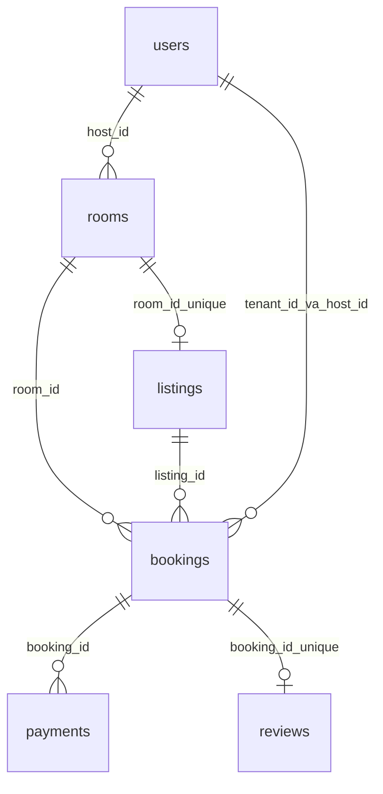
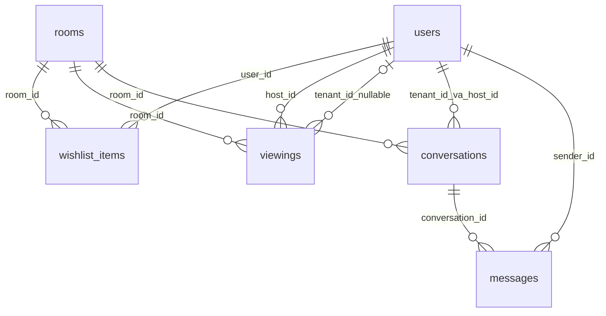
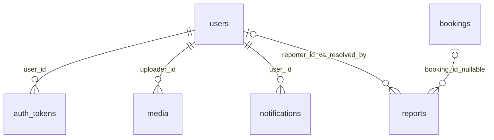
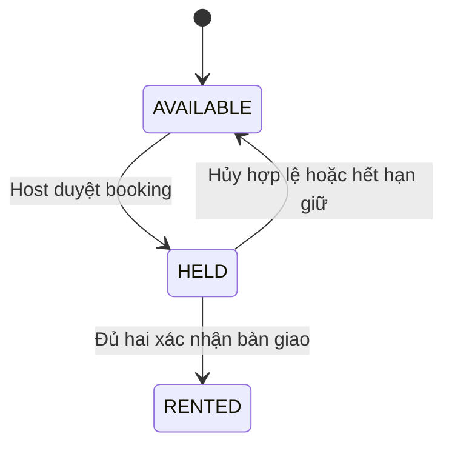
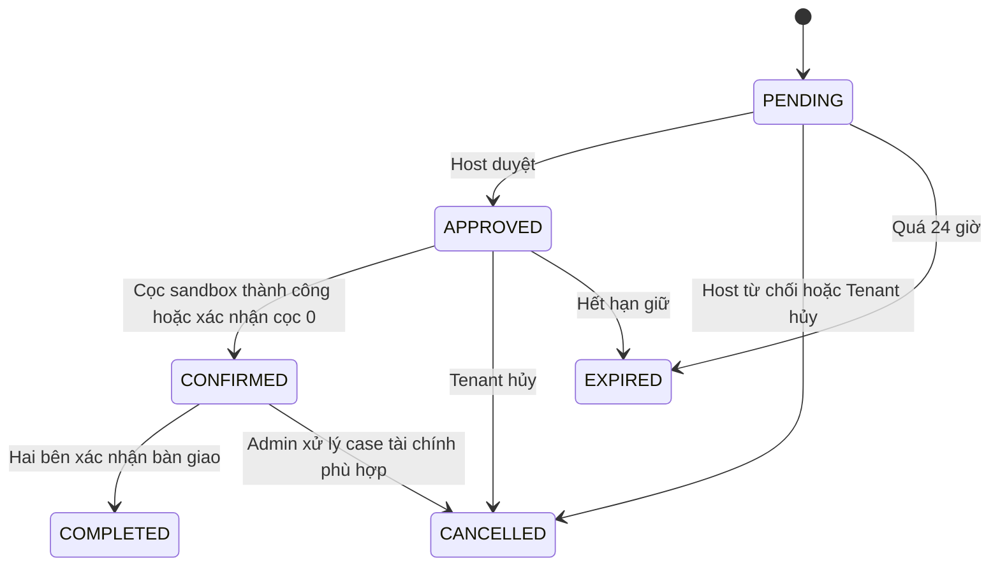

# ROOMLY — Hiểu database 14 bảng

Ngày đối chiếu: **16/10/2026**. Đọc cùng [tài liệu tổng quan dự án](ROOMLY_TEAM_GUIDE.md).

Database được mô tả là **`homely_student14`**, MySQL **8.0.45**, đang phục vụ backend Roomly profile `student14`. Kiểm tra metadata trực tiếp xác nhận **14 bảng, 227 cột, 28 khóa ngoại**. Danh sách cột, kiểu dữ liệu, nullable và liên kết FK trùng với DDL trong `Infra/student14/init/001_schema.sql` tại thời điểm viết.

Chỉ đọc metadata khi soạn tài liệu; không reset, import, thay đổi schema hay sửa dữ liệu. File SQL nói trên là bản dump có lệnh `DROP TABLE`: dùng để đối chiếu cấu trúc trong tài liệu này, **không chạy lại lên database demo đang dùng**.

## Mục lục

1. [Nhìn tổng thể 14 bảng](#1-nhìn-tổng-thể-14-bảng)
2. [Ba đối tượng phải phân biệt](#2-ba-đối-tượng-phải-phân-biệt)
3. [Sơ đồ quan hệ chia theo nhóm](#3-sơ-đồ-quan-hệ-chia-theo-nhóm)
4. [Giải thích từng bảng](#4-giải-thích-từng-bảng)
5. [JSON: phụ phí, tiện ích và snapshot](#5-json-phụ-phí-tiện-ích-và-snapshot)
6. [Trạng thái và thời hạn](#6-trạng-thái-và-thời-hạn)
7. [Ràng buộc, index và transaction](#7-ràng-buộc-index-và-transaction)
8. [Bản đồ đủ 28 khóa ngoại](#8-bản-đồ-đủ-28-khóa-ngoại)
9. [SQL chỉ đọc để hiểu và kiểm tra](#9-sql-chỉ-đọc-để-hiểu-và-kiểm-tra)
10. [Hỏi đáp khi báo cáo](#10-hỏi-đáp-khi-báo-cáo)
11. [Từ điển đầy đủ các cột](#11-từ-điển-đầy-đủ-các-cột)

## 1. Nhìn tổng thể 14 bảng

| Nhóm | Bảng | Một bản ghi đại diện cho |
|---|---|---|
| Tài khoản | `users` | Một tài khoản, có thể có nhiều vai trò |
| Xác thực | `auth_tokens` | Một refresh token hoặc mã xác minh/khôi phục đã hash |
| Phòng | `rooms` | Một phòng vật lý thuộc một Host |
| Tin đăng | `listings` | Tin rao thuê duy nhất của một phòng, gồm giá/cọc/phụ phí |
| Tệp ảnh | `media` | Metadata một file ảnh; file thực nằm trên ổ đĩa |
| Yêu thích | `wishlist_items` | Một user lưu một phòng |
| Lịch xem | `viewings` | Một khung giờ xem phòng, có thể chưa hoặc đã có Tenant |
| Hội thoại | `conversations` | Một cuộc trao đổi của một Tenant với Host về một phòng |
| Tin nhắn | `messages` | Một tin nhắn trong hội thoại |
| Yêu cầu thuê | `bookings` | Một lần Tenant đề nghị thuê phòng với điều khoản đã chụp lại |
| Thanh toán | `payments` | Một phiên/giao dịch cọc của một booking |
| Đánh giá | `reviews` | Một đánh giá của Tenant sau khi hoàn tất booking |
| Báo cáo | `reports` | Một báo cáo nội dung hoặc khiếu nại booking |
| Thông báo | `notifications` | Một thông báo gửi đến một user, kèm trạng thái gửi push |

Schema thu gọn bằng cách giữ một số dữ liệu nhỏ trong cột JSON, dùng cờ vai trò trong `users`, gộp lịch trống/yêu cầu xem vào `viewings` và gộp báo cáo/khiếu nại vào `reports`. Vì vậy không có bảng riêng cho roles, phụ phí, bàn giao hay thiết bị push trong bản này.

## 2. Ba đối tượng phải phân biệt

| Đối tượng | Câu hỏi nó trả lời | Dữ liệu tiêu biểu |
|---|---|---|
| `rooms` — phòng | Phòng ở đâu, diện tích bao nhiêu, đang trống hay đã cho thuê? | Host, mã phòng, địa chỉ, sức chứa, tiện ích, `availability` |
| `listings` — tin đăng | Phòng được rao thế nào, giá/cọc/phụ phí gì, đã duyệt chưa? | Tiêu đề, mô tả, giá, phụ phí, `status` |
| `bookings` — yêu cầu thuê | Ai muốn thuê phòng nào, với điều khoản nào, đã thanh toán/bàn giao chưa? | Tenant, Host, phòng/tin, snapshot, trạng thái thuê |

Ví dụ minh họa: Host có phòng mã `DEMO-A01`, tạo tin “Studio gần trường” giá 3.100.000đ, cọc 1.000.000đ. Tenant gửi yêu cầu thuê tin đó. Ba bản ghi có ba ID độc lập; không dùng ID tin để thay ID phòng chỉ vì dữ liệu mẫu có lúc cùng số.

Quan hệ thực tế:

- Một Host có nhiều phòng.
- Một phòng có **0 hoặc 1 tin**, vì `listings.room_id` có unique.
- Một phòng/tin có nhiều booking qua các lần yêu cầu; nhiều Tenant có thể cùng gửi `PENDING`.
- Tại một thời điểm, chỉ một booking được ở trạng thái giữ/xác nhận thuê của một phòng.
- Một booking có thể có nhiều lần thử thanh toán, nhưng chỉ một payment `PENDING` tại một thời điểm và tối đa một payment được gắn vào `allocated_payment_id`.
- Một booking có tối đa một review.

## 3. Sơ đồ quan hệ chia theo nhóm

Các sơ đồ cố ý chia nhỏ để đọc được trên GitHub/VS Code, không thay đổi hay xóa quan hệ trong MySQL. Những liên kết không vẽ ở một sơ đồ vẫn được liệt kê đầy đủ ở phần 8.

### 3.1. Phòng, tin và thuê phòng



`bookings.allocated_payment_id → payments.id` là liên kết chọn payment cọc đã dùng, bổ sung cho chiều `payments.booking_id → bookings.id`. Hai FK `tenant_id` và `host_id` được gộp nhãn trong hình để giảm dây; chúng là hai khóa riêng trong DB.

### 3.2. Tương tác trước khi thuê



### 3.3. Tài khoản, ảnh và quản trị



`media.resource_type/resource_id`, `reports.target_type/target_id` và `notifications.ref_type/ref_id` là tham chiếu theo cặp loại + ID, không phải mọi cặp đều có FK vật lý. Service chịu trách nhiệm xác minh đối tượng và quyền truy cập. Riêng `reports.booking_id` có FK thật tới booking.

## 4. Giải thích từng bảng

### 4.1. `users` — tài khoản và vai trò

Lưu email, password BCrypt, họ tên, điện thoại, avatar, trạng thái email và trạng thái tài khoản. Vai trò là các cờ độc lập; một người có thể vừa thuê vừa cho thuê. User mới mặc định có quyền Tenant, chưa có quyền Host/Admin và chưa xác minh email.

`status` nhận `ACTIVE`, `SUSPENDED`, `DELETED`. Có giá trị `DELETED` trong schema không có nghĩa hiện có đầy đủ API xóa tài khoản. Admin hiện có thao tác suspend/activate. Backend kiểm tra trạng thái tài khoản khi xử lý request, không chỉ tin vào giao diện FE.

Nhóm `fcm_*` lưu một thiết bị push hiện hành cho mỗi user. `fcm_token_hash` được MySQL sinh từ token để tạo unique; không phải access token hay password. `transaction_push`, `chat_push` và các cờ thông báo khác là tùy chọn; có cột không đồng nghĩa mọi loại thông báo đã có màn hình/chức năng riêng.

Ràng buộc chính: email unique; FCM hash và installation ID unique khi có giá trị; các cờ chỉ 0/1. Khi đọc DB phục vụ báo cáo, không xuất password hash hoặc token.

Code chính: `AuthService`, `AuthRepository`, `PushService`, `PushRepository`, `AdminService`.

### 4.2. `auth_tokens` — refresh token, xác minh và khôi phục

Dùng chung một bảng với `purpose` gồm `REFRESH`, `EMAIL_VERIFICATION`, `PASSWORD_RESET`. Mỗi dòng lưu SHA-256 trong `token_hash`, thời điểm hết hạn và `consumed_at`.

`consumed_at IS NULL` mới chỉ là chưa dùng/thu hồi; vẫn phải kiểm tra `expires_at`. Refresh token còn cần installation/device. Access JWT được ký và gửi cho client, không có một dòng riêng trong bảng này cho từng access token.

Access token có hạn 15 phút; refresh 30 ngày và rotate khi dùng. OTP có hạn 10 phút; hash OTP gắn với user và mục đích. Reset password thu hồi các token chưa dùng của tài khoản. Logout thu hồi refresh token của installation và gỡ token push tương ứng; không nên mô tả logout là xóa mọi JWT đã phát khỏi DB.

Unique `token_hash` chống trùng. Index user/purpose/consumed và expires hỗ trợ tìm token còn hiệu lực.

### 4.3. `rooms` — dữ liệu phòng

Lưu chủ phòng `host_id`, mã nội bộ `unit_code`, tên, mô tả vật lý, loại phòng, diện tích, sức chứa, địa chỉ, tọa độ và tiện ích. `unit_code` chỉ unique **trong từng Host** qua `(host_id, unit_code)`; hai Host khác nhau có thể có cùng mã nội bộ.

Loại phòng: `SINGLE_ROOM`, `STUDIO`, `MINI_APARTMENT`. Diện tích DB cho phép 2–1000 m², sức chứa 1–10 người. `amenity_ids` là mảng JSON ID từ catalog 15 tiện ích trong resource backend.

`availability` có ba giá trị: `AVAILABLE` — trống, `HELD` — đã giữ, `RENTED` — đã bàn giao/cho thuê. Giá và phụ phí nằm ở `listings`, không ở `rooms`.

Có cột tỉnh/phường/tọa độ trong DB, nhưng `SaveRoomDTO` hiện nhận chủ yếu địa chỉ dạng dòng và thông tin phòng; không nên khẳng định UI hiện đã nhập/ghi đủ mọi cột địa lý. Cột nullable trong DB vẫn có thể bị DTO yêu cầu nhập, ví dụ `address_line`.

### 4.4. `listings` — nội dung tin, giá và duyệt

`room_id` là FK và unique: mỗi phòng tối đa một tin. Tin chứa `title`, `description`, `rent_vnd`, `deposit_vnd`, JSON `fees`, trạng thái duyệt, lý do xử lý và hạn công khai.

DB cho phép giá/cọc NULL trong một số trạng thái; API lưu tin hiện tại yêu cầu giá thuê dương, cọc không âm, tiêu đề/mô tả đầy đủ. `PUBLISHED` ở DB phải có giá, cọc và `published_at`.

Host sửa tin hợp lệ sẽ về `DRAFT` và tăng `terms_version`. Admin duyệt ghi thời điểm công khai, đặt hạn sau 30 ngày. Job hết hạn chuyển tin công khai quá hạn sang `EXPIRED`.

`terms_version` là phiên bản điều khoản; `version` là bộ đếm thay đổi kỹ thuật, không phải trạng thái. Không suy ra toàn bộ update đã có optimistic locking chỉ vì cột tên `version` tồn tại.

### 4.5. `media` — metadata file ảnh

Lưu người upload, mục đích, đối tượng gắn ảnh, loại nội dung, dung lượng, tên lưu trữ và kích thước. `uploader_id` là FK. Liên kết tới phòng dùng `resource_type = 'room'` và `resource_id`; đây là liên kết do ứng dụng quản lý, không có FK `resource_id → rooms.id`.

Runtime `student14` hiện nhận JPG/PNG tối đa 4 MB, tối đa 16 triệu pixel, chuẩn hóa JPEG rồi lưu file local. DB chỉ lưu `storage_key` là tên file. URL nội dung được BE tạo dạng `/api/v1/media/{id}/content`.

Comment cũ trong DDL có nhắc MinIO; hành vi hiện tại phải đọc theo `MediaService`: **lưu local**. Upload ảnh mới đánh dấu ảnh phòng cũ `DELETED`; API hiện thay ảnh đại diện. Schema hỗ trợ nhiều dòng/sắp xếp nhưng không vì vậy khẳng định UI có đầy đủ quản lý album. Xóa metadata kiểu này không đồng nghĩa file cũ lập tức bị xóa vật lý.

Trạng thái DB: `READY`, `ATTACHED`, `DELETED`. Unique `storage_key` chống hai metadata dùng trùng tên file.

### 4.6. `wishlist_items` — phòng đã lưu

Bảng nối user–room. Unique `(user_id, room_id)` ngăn một người lưu trùng cùng phòng. Hai FK có `ON DELETE CASCADE`; phần lớn FK khác trong DB không cascade.

Lưu theo phòng giúp thay đổi nội dung tin không đổi đối tượng đã yêu thích. Feed yêu thích vẫn cần điều kiện hiển thị tin phù hợp; không coi việc có dòng wishlist là bảo đảm tin luôn còn công khai.

### 4.7. `viewings` — khung giờ và yêu cầu xem phòng

Khi Host mở khung giờ, `tenant_id = NULL`, `requested_at = NULL`, trạng thái `OPEN`. Khi Tenant yêu cầu, cùng dòng được gắn Tenant và chuyển `REQUESTED`. Host duyệt thành `CONFIRMED`; từ chối thành `CANCELLED_BY_HOST` và ghi lý do.

Một dòng chỉ gắn tối đa một Tenant; không có bảng slot và appointment riêng. Nếu một lịch đã gắn Tenant bị hủy thì service hiện không cho mở lại lịch đó như slot trống. Reopen chỉ dành cho slot bị Host đóng mà chưa từng có Tenant.

BE kiểm tra giờ tương lai, thời lượng tối đa 3 giờ và khoảng thời gian không chồng nhau của cùng phòng. Unique `(room_id, active_start_at)` chỉ chặn trùng thời điểm bắt đầu; kiểm tra **chồng khoảng giờ** nằm trong service/repository dưới khóa phòng.

DB còn cho phép `COMPLETED`, `NO_SHOW`; API action hiện chưa có đầy đủ thao tác chuyển tới hai trạng thái đó. Không coi việc có enum/check là đã triển khai mọi nghiệp vụ.

### 4.8. `conversations` — hội thoại

Một hội thoại gắn với phòng, Tenant và Host. Unique `(room_id, tenant_id)` để Tenant mở lại chat về cùng phòng không tạo cuộc trò chuyện mới. Host có thể có nhiều hội thoại với các Tenant khác nhau.

`room_title` là nhãn lưu khi tạo; `last_message_at` và `last_message_preview` phục vụ danh sách chat. `sequence` là thứ tự tin cuối, hai cặp `*_read_sequence`/`*_read_at` là mốc đã đọc của mỗi bên. Không có bảng thành viên chat nhiều người: mô hình hiện tại là chat 1–1 theo phòng.

### 4.9. `messages` — tin nhắn

`conversation_id` và `sender_id` là FK. `sequence` unique trong mỗi hội thoại giúp lấy tin theo thứ tự. `client_message_id` do client cấp; unique cùng conversation giúp gửi lại cùng một tin không tạo bản ghi thứ hai.

API hiện chủ yếu gửi `TEXT`, tối đa 3.000 ký tự theo service. `content_type` tồn tại không có nghĩa đã có upload video/voice. FE đang dùng REST polling khoảng 4 giây, không lấy dependency WebSocket trong POM làm bằng chứng chat hiện chạy WebSocket.

### 4.10. `bookings` — yêu cầu thuê, điều khoản và bàn giao

Đây là bảng trung tâm của luồng thuê. Có FK Tenant, Host, phòng, tin và payment cọc được chọn. Backend lấy chủ phòng/giá từ DB, không tin các trường định danh chủ phòng hoặc giá do FE tự đặt.

Giá thuê, cọc và `terms_snapshot` lưu lúc tạo booking. Snapshot hiện chứa giá/cọc, phụ phí, `terms_version` của tin và sức chứa. Một số nhãn ở API chi tiết như tiêu đề/địa chỉ vẫn JOIN tin/phòng hiện tại; snapshot không phải bản sao toàn bộ đối tượng.

Các deadline chia rõ: request chờ duyệt, thời gian giữ phòng, hạn bàn giao. Hai cột `tenant_handover_confirmed_at` và `host_handover_confirmed_at` giúp kiểm tra mỗi bên đã xác nhận chưa. Không cần bảng bàn giao riêng cho quy trình xác nhận đơn giản này.

`allocated_payment_id` ban đầu NULL. Khi sandbox thanh toán thành công, nó trỏ tới payment cọc của booking. Cần kiểm tra payment thuộc đúng booking, đúng số tiền và `SUCCEEDED` ở service; FK chỉ bảo đảm ID tồn tại.

Hai cột generated `open_room_id`, `active_room_id` phục vụ unique theo trạng thái, giải thích tại phần 7. Một request bị Host từ chối được lưu `CANCELLED` + `cancel_reason_code = HOST_REJECTED`; **booking không có trạng thái `REJECTED`**.

### 4.11. `payments` — các lần thanh toán cọc

Mỗi dòng thuộc một booking và một payer. Một booking có thể thử thanh toán nhiều lần; các lần thất bại/hết hạn vẫn được lưu. `pending_booking_id` là generated column để chỉ cho phép một phiên `PENDING`/booking.

Luồng đang dùng là `MOCK_SANDBOX`, `is_test = 1`, tiền VND dương. API tái dùng payment đang còn hạn hoặc đã thành công thay vì tạo phiên mới mỗi lần bấm. Sandbox chỉ cho mô phỏng payment test, không biến một payment cổng thật thành thành công qua cùng API.

Schema cho phép provider `VNPAY`, `MOMO`, nhưng code luồng này không chứng minh tích hợp hay thu tiền thật. Các trường refund lưu kết quả hoàn cọc sandbox khi Admin xử lý khiếu nại; không phải lệnh chuyển tiền ngân hàng thật.

### 4.12. `reviews` — đánh giá sau bàn giao

Một review trỏ tới booking, reviewer và room. Unique `booking_id` cho phép tối đa một đánh giá/booking; điểm 1–5. Service chỉ cho Tenant của booking đã `COMPLETED` gửi đánh giá.

`visible`/`hide_reason` hỗ trợ ẩn đánh giá; danh sách công khai chỉ lấy `visible = true`. Có cột hỗ trợ ẩn không có nghĩa toàn bộ UI/API quản lý review đã được nghiệm thu.

### 4.13. `reports` — báo cáo tin và khiếu nại thuê

Gộp hai loại vào một bảng bằng `target_type`, `target_id`. API tạo report hiện nhận `listing` và `booking`; DB còn cho phép `review`, `message`, `user` để lưu được các loại đó nhưng không khẳng định API hiện đã hỗ trợ tạo chúng.

Với báo cáo tin: `reporter_id` có giá trị, `booking_id` NULL, không có quyết định chia cọc. Với khiếu nại booking: `booking_id = target_id`, lý do thuộc `DEPOSIT_DISPUTE`, `HANDOVER_OVERDUE`, `NO_SHOW`, `OTHER`; người gửi phải thuộc booking đã `CONFIRMED`/`COMPLETED`. Schema cho phép reporter NULL cho case hệ thống nhưng job hiện chưa tự mở mọi case đó.

Admin có quyết định `REFUND_TENANT`, `FORFEIT_DEPOSIT`, `SPLIT`, `NO_ACTION`. Quyết định tài chính kiểm tra payment sandbox thành công, cùng booking, đúng số cọc và chưa xử lý tài chính trước đó. Chia cọc yêu cầu phần hoàn lớn hơn 0 và nhỏ hơn cọc.

Khi có quyết định tài chính cho booking đang `CONFIRMED`, service có thể hủy booking và trả phòng `AVAILABLE`. Với booking đã `COMPLETED`, xử lý case không tự coi là một luồng trả phòng. Đóng báo cáo tin cũng không tự tạm ngưng tin; moderation tin là API riêng.

### 4.14. `notifications` — thông báo trong app và hàng chờ push

`user_id` là người nhận; title/body là nội dung; `ref_type`/`ref_id` xác định màn hình cần mở. Hai trường tham chiếu phải cùng có hoặc cùng không có; không có FK cho mọi loại đối tượng tham chiếu.

`is_read` là trạng thái người dùng đã đọc. Nhóm `push_status`, `push_attempts`, `push_next_attempt_at`, `pushed_at` là trạng thái gửi FCM, **độc lập với đã đọc**.

Khi push bật, job chạy khoảng 5 giây/lần, có retry và giới hạn số lần thử. Các trạng thái job dùng gồm `PENDING`, `PROCESSING`, `SENT`, `SKIPPED`, `FAILED`; DDL hiện không có CHECK riêng cho tập giá trị push này. Khi push tắt, thông báo trong app vẫn tồn tại; một dòng `PENDING` không chứng minh FCM đã gửi.

## 5. JSON: phụ phí, tiện ích và snapshot

### 5.1. `rooms.amenity_ids`

```json
[1, 3, 8]
```

Là danh sách ID, BE tra catalog ở `backend/src/main/resources/student14-amenities.json`. ID hợp lệ từ 1 đến 15 và không trùng. DB chỉ kiểm tra JSON là ARRAY; kiểm tra ID nằm trong catalog là trách nhiệm BE.

### 5.2. `listings.fees`

```json
[
  {
    "fee_code": "ELECTRICITY",
    "fee_mode": "PER_UNIT",
    "unit_name": "kWh",
    "amount_vnd": 4000
  }
]
```

Đây là một mảng nhỏ có schema cố định. Không có dòng con mang ID phí riêng: FE thêm/sửa/xóa phần tử và BE lưu lại mảng. Mã gồm 7 loại cố định; không được trùng. `PER_UNIT` cần đơn vị; `FIXED` không bắt buộc đơn vị. Tiền nguyên VND, không âm, tối đa 18 chữ số.

`SaveListingDTO` khai báo tối đa 12 phần tử, nhưng với 7 mã hợp lệ và điều kiện không trùng, số khoản hợp lệ thực tế tối đa 7. `[]` nghĩa là không có phụ phí, khác với chưa tải được dữ liệu hoặc gửi `null`.

DB kiểm tra ARRAY, DTO/service kiểm tra từng phần tử. Vì vậy dữ liệu JSON hợp cú pháp chưa chắc hợp nghiệp vụ. Nếu trực tiếp ghi JSON sai mã bằng SQL, có thể vượt các kiểm tra của API.

### 5.3. `bookings.terms_snapshot`

Ví dụ cấu trúc hiện tại:

```json
{
  "rent_vnd": "3100000",
  "deposit_vnd": "1000000",
  "terms_version": 2,
  "fees": [
    {
      "fee_code": "ELECTRICITY",
      "fee_mode": "PER_UNIT",
      "unit_name": "kWh",
      "amount_vnd": 4000
    }
  ],
  "max_occupants": 2
}
```

Snapshot giúp giữ điều khoản thỏa thuận dù nội dung tin sau này đổi. `snapshot_schema_version` mô tả phiên bản **cấu trúc snapshot**; `terms_version` trong JSON là phiên bản **điều khoản tin**. Hai trường khác mục đích.

Lợi ích JSON trong phạm vi đồ án: giảm bảng/join cho dữ liệu nhỏ, FE gửi/nhận thuận tiện. Đổi lại, khó FK vào từng phần tử, khó thống kê sâu và cần validate ở ứng dụng. Schema này vẫn có quan hệ cho các đối tượng chính; không nên nói toàn bộ DB đạt chuẩn hóa 3NF tuyệt đối hoặc dùng JSON để thay mọi quan hệ.

## 6. Trạng thái và thời hạn

### 6.1. Trạng thái phòng



Luồng trả phòng kết thúc thời hạn thuê dài hạn chưa được mô tả thành một API hoàn chỉnh trong runtime này. Không tự đổi `RENTED` về `AVAILABLE` để chạy lại dữ liệu demo.

### 6.2. Trạng thái tin đăng

| Trạng thái | Ý nghĩa | Host sửa nội dung? | Host gửi duyệt? |
|---|---|---|---|
| `DRAFT` | Bản nháp | Có, nếu phòng trống | Có |
| `PENDING_REVIEW` | Chờ Admin duyệt | Không | Không gửi lặp |
| `PUBLISHED` | Đã công khai | Có nếu phòng trống; lưu sẽ về DRAFT | Không gửi trực tiếp |
| `HIDDEN` | Host tự ẩn | Có nếu phòng trống | Có |
| `REJECTED` | Admin từ chối | Có nếu phòng trống | Có |
| `SUSPENDED` | Admin tạm ngưng | Không | Không |
| `EXPIRED` | Hết hạn tin | Có nếu phòng trống | Có |
| `ARCHIVED` | Trạng thái lưu trữ được schema/enum nhận | Không có luồng Host sửa | Không |

Admin approve/reject chỉ áp dụng `PENDING_REVIEW`. Admin suspend áp dụng `PUBLISHED` hoặc `HIDDEN`, bắt buộc lý do; Host hide chỉ áp dụng `PUBLISHED`. API hiện không có đầy đủ luồng archive/unarchive hay khôi phục tin bị Admin suspend.

Feed khám phá lọc đồng thời: tin `PUBLISHED`, chưa hết hạn và phòng `AVAILABLE`. Không suy ra chỉ cần tin `PUBLISHED` là chắc chắn hiện trong feed. API chi tiết còn phân quyền riêng cho Host/Admin khi tin chưa công khai.

### 6.3. Booking và payment



| Loại | Giá trị / thời hạn hiện tại |
|---|---|
| Booking | `PENDING`, `APPROVED`, `CONFIRMED`, `COMPLETED`, `CANCELLED`, `EXPIRED` |
| Payment | `PENDING`, `SUCCEEDED`, `FAILED`, `EXPIRED` |
| Request chờ duyệt | 24 giờ từ khi tạo |
| Giữ phòng sau duyệt | 24 giờ từ khi Host duyệt |
| Phiên thanh toán | Tối đa 30 phút, không quá hạn giữ |
| Hạn bàn giao | Ghi sau 7 ngày từ xác nhận thuê |
| Tin công khai | 30 ngày từ khi Admin approve |
| Job hết hạn | Chạy khoảng 60 giây/lần |

Job hiện xử lý request `PENDING`, hold `APPROVED`, payment quá hạn và listing hết hạn. Không có nghĩa mọi `CONFIRMED` quá `handover_due_at` đều tự hủy/hoàn tiền hoặc tự mở khiếu nại. Các API cũng kiểm tra deadline trực tiếp, nên hết hạn không phải đợi job chạy mới bị từ chối.

`COMPLETED` là bàn giao xong; giá trị trạng thái phòng tương ứng là **`RENTED`**, không phải `OCCUPIED` trong schema này.

### 6.4. Các bảng còn lại

| Bảng | Trạng thái DB cho phép | Lưu ý triển khai |
|---|---|---|
| `users` | ACTIVE, SUSPENDED, DELETED | API quản trị hiện có suspend/activate |
| `viewings` | OPEN, REQUESTED, CONFIRMED, COMPLETED, CANCELLED_BY_TENANT, CANCELLED_BY_HOST, NO_SHOW | Action hiện tập trung mở/yêu cầu/duyệt/hủy/reopen phù hợp |
| `reports` | OPEN, IN_REVIEW, RESOLVED, CLOSED | API resolve nhận xử lý theo loại report |
| `media` | READY, ATTACHED, DELETED | Ảnh phục vụ nội dung dùng ATTACHED |
| `payments.refund_status` | NULL, PENDING, SUCCEEDED, FAILED | Luồng xử lý cọc hiện là sandbox |

## 7. Ràng buộc, index và transaction

### 7.1. PK, FK, UNIQUE, CHECK khác nhau thế nào?

| Loại | Chức năng | Ví dụ thực tế |
|---|---|---|
| PRIMARY KEY | Nhận diện một dòng | `rooms.id` |
| FOREIGN KEY | ID tham chiếu phải tồn tại | `rooms.host_id → users.id` |
| UNIQUE | Không cho trùng một giá trị/tổ hợp | `listings.room_id`, `users.email` |
| CHECK | Kiểm tra giá trị ngay trong DB | rating 1–5, số người 1–10, trạng thái hợp lệ |
| INDEX thường | Hỗ trợ truy vấn; không tự cấm trùng | `(status, expires_at)` |

FK không tự bảo đảm `host_id` có cờ Host, payment đúng số tiền, listing thuộc đúng room, hoặc user hiện tại là chủ đối tượng. Những điều đó còn cần service kiểm tra.

Tiền dùng `DECIMAL(18,0)` và `BigDecimal` ở BE, tránh sai số tiền khi dùng float/double. Định dạng có dấu chấm và ký hiệu đồng chỉ là việc hiển thị ở FE.

### 7.2. Generated column giúp tránh trùng theo trạng thái

| Cột sinh | Cách hiểu | Unique bảo vệ |
|---|---|---|
| `bookings.open_room_id` | Bằng room_id khi PENDING/APPROVED/CONFIRMED, còn lại NULL | `(tenant_id, open_room_id)`: một Tenant không mở hai request thuê cùng phòng |
| `bookings.active_room_id` | Bằng room_id khi APPROVED/CONFIRMED, còn lại NULL | Một phòng chỉ có một booking được giữ/xác nhận |
| `payments.pending_booking_id` | Bằng booking_id khi PENDING, còn lại NULL | Một phiên payment chờ/booking |
| `reports.open_booking_id` | Bằng booking_id khi case booking OPEN/IN_REVIEW | Một case đang mở/booking |
| `viewings.active_start_at` | Bằng start_at khi OPEN/REQUESTED/CONFIRMED | Một khung giờ đang hoạt động cùng mốc bắt đầu/phòng |
| `users.fcm_token_hash` | SHA-256 của FCM token | Token thiết bị không gắn trùng cho hai user |

Các cột này do MySQL tính; FE/BE không gửi giá trị trực tiếp. Unique của MySQL cho phép nhiều NULL, nên dòng lịch sử không còn hoạt động không bị buộc giữ giá trị unique như dòng đang hoạt động.

`uk_bookings_allocated_payment` còn ngăn hai booking cùng trỏ một payment. Nó không thay thế kiểm tra payment thuộc đúng booking.

### 7.3. Vì sao vẫn cần khóa khi DB đã có unique?

Unique chặn dữ liệu cuối cùng bị trùng; khóa giúp cả chuỗi kiểm tra–ghi diễn ra nhất quán. Các service liên quan dùng `@Transactional`, isolation mặc định của pool được đặt `READ_COMMITTED`.

Khi duyệt/thu tiền/hết hạn, luồng booking thống nhất khóa **room → booking → payment nếu cần**. Khi xử lý case, khóa room/booking trước report rồi payment. Khung giờ xem cũng khóa phòng trước lịch. Cùng thứ tự khóa giúp giảm khả năng deadlock giữa các luồng.

Ví dụ hai Host action cùng duyệt hai request của một phòng: request đầu lấy khóa và đổi phòng `HELD`; request sau đọc trạng thái đã đổi rồi trả 409. Unique active_room_id là lớp bảo vệ bổ sung.

`version` được tăng ở nhiều thao tác, nhưng không phải mọi UPDATE đều có `WHERE version = ...`. Cơ chế chống tranh chấp đã thấy ở luồng chính là transaction + khóa dòng + constraint, không nên giải thích thành JPA `@Version`.

### 7.4. Index chính phục vụ màn hình nào?

| Index / nhóm cột | Mục đích |
|---|---|
| `users.email` unique | Tìm tài khoản và ngăn đăng ký trùng |
| `rooms(host_id, unit_code)` unique | Mã phòng theo chủ nhà |
| `rooms(availability, room_type, province_code, area_m2)` | Hỗ trợ lọc phòng |
| `listings(status, published_at, id)` | Hỗ trợ truy vấn danh sách tin theo trạng thái/thời gian |
| `listings(status, rent_vnd, id)` | Hỗ trợ truy vấn theo giá/trạng thái |
| `listings(status, expires_at)` | Tìm tin hết hạn |
| `bookings(tenant_id, created_at)` / `(host_id, created_at)` | Danh sách yêu cầu của từng bên |
| `bookings(status, request_expires_at)` / `(status, hold_expires_at)` | Job hết hạn |
| `payments(booking_id, created_at)` | Lịch sử thử thanh toán |
| `messages(conversation_id, sequence)` unique | Lấy tin đúng thứ tự |
| `notifications(user_id, is_read, created_at, id)` | Thông báo chưa đọc |
| `reports(target_type, status, created_at)` | Danh sách quản trị báo cáo |

Index là cấu trúc hỗ trợ, không chứng minh mọi truy vấn hiện tại đều tận dụng đầy đủ. Bản này chưa được mô tả là đã tối ưu cho tải lớn hay phân trang server hoàn chỉnh.

## 8. Bản đồ đủ 28 khóa ngoại

Mỗi dòng dưới đây là một FK vật lý đã kiểm tra. Trừ hai dòng wishlist có cascade, các FK còn lại dùng quy tắc xóa mặc định kiểu RESTRICT/NO ACTION của MySQL; không tự xóa dây chuyền dữ liệu thuê/thanh toán.

| # | Bảng.cột tham chiếu | Đích |
|---|---|---|
| 1 | `auth_tokens.user_id` | `users.id` |
| 2 | `rooms.host_id` | `users.id` |
| 3 | `listings.room_id` | `rooms.id` |
| 4 | `media.uploader_id` | `users.id` |
| 5 | `wishlist_items.user_id` | `users.id`, DELETE CASCADE |
| 6 | `wishlist_items.room_id` | `rooms.id`, DELETE CASCADE |
| 7 | `viewings.room_id` | `rooms.id` |
| 8 | `viewings.host_id` | `users.id` |
| 9 | `viewings.tenant_id` | `users.id`, nullable |
| 10 | `conversations.room_id` | `rooms.id` |
| 11 | `conversations.tenant_id` | `users.id` |
| 12 | `conversations.host_id` | `users.id` |
| 13 | `messages.conversation_id` | `conversations.id` |
| 14 | `messages.sender_id` | `users.id` |
| 15 | `bookings.tenant_id` | `users.id` |
| 16 | `bookings.host_id` | `users.id` |
| 17 | `bookings.room_id` | `rooms.id` |
| 18 | `bookings.listing_id` | `listings.id` |
| 19 | `bookings.allocated_payment_id` | `payments.id`, nullable |
| 20 | `payments.booking_id` | `bookings.id` |
| 21 | `payments.payer_id` | `users.id` |
| 22 | `reviews.booking_id` | `bookings.id` |
| 23 | `reviews.reviewer_id` | `users.id` |
| 24 | `reviews.room_id` | `rooms.id` |
| 25 | `reports.reporter_id` | `users.id`, nullable |
| 26 | `reports.resolved_by` | `users.id`, nullable |
| 27 | `reports.booking_id` | `bookings.id`, nullable |
| 28 | `notifications.user_id` | `users.id` |

Các trường audit `created_by`, `updated_by` là chuỗi, không có FK tới `users.id`. `ref_id`, `target_id`, `resource_id` cũng không được mặc định hiểu là FK chỉ vì tên kết thúc bằng `_id`.

## 9. SQL chỉ đọc để hiểu và kiểm tra

Các truy vấn dưới đây không ghi dữ liệu. Chạy trong connection tới đúng schema; ID #38/#40 là ví dụ của lần nghiệm thu 15/10, có thể không tồn tại trên máy khác.

### 9.1. Xác định schema và xem danh sách bảng

```sql
SELECT DATABASE() AS current_schema, VERSION() AS mysql_version;

SELECT TABLE_NAME
FROM information_schema.TABLES
WHERE TABLE_SCHEMA = 'homely_student14'
  AND TABLE_TYPE = 'BASE TABLE'
ORDER BY TABLE_NAME;
```

### 9.2. Xem phòng và tin DEMO, giải thích vì sao chưa có trên feed

```sql
SELECT r.id AS room_id, r.unit_code, r.host_id, r.availability,
       l.id AS listing_id, l.title, l.status,
       l.rent_vnd, l.deposit_vnd, l.published_at, l.expires_at
FROM homely_student14.rooms r
LEFT JOIN homely_student14.listings l ON l.room_id = r.id
WHERE r.unit_code LIKE 'DEMO-%'
ORDER BY r.id DESC;

-- Điều kiện cốt lõi của feed khám phá.
SELECT l.id AS listing_id, r.id AS room_id, l.title
FROM homely_student14.listings l
JOIN homely_student14.rooms r ON r.id = l.room_id
WHERE l.status = 'PUBLISHED'
  AND r.availability = 'AVAILABLE'
  AND (l.expires_at IS NULL OR l.expires_at > UTC_TIMESTAMP(3))
ORDER BY l.id DESC;
```

### 9.3. Kiểm tra phụ phí và snapshot

```sql
SELECT id, room_id, status, JSON_PRETTY(fees) AS current_fees
FROM homely_student14.listings
WHERE id = 38;

SELECT id, room_id, listing_id, rent_vnd, deposit_vnd,
       JSON_PRETTY(terms_snapshot) AS agreed_terms,
       JSON_EXTRACT(terms_snapshot, '$.fees') AS agreed_fees
FROM homely_student14.bookings
WHERE id = 40;
```

`current_fees` và `agreed_fees` có thể khác nếu tin được sửa sau khi tạo booking. Đây chính là mục đích của snapshot; không sửa snapshot để khớp tin mới.

### 9.4. Theo dõi booking, payment và bàn giao

```sql
SELECT b.id AS booking_id, b.room_id, b.tenant_id, b.host_id,
       b.status AS booking_status, r.availability,
       b.allocated_payment_id, p.status AS payment_status,
       p.provider, p.is_test, p.amount_vnd,
       b.tenant_handover_confirmed_at,
       b.host_handover_confirmed_at, b.completed_at
FROM homely_student14.bookings b
JOIN homely_student14.rooms r ON r.id = b.room_id
LEFT JOIN homely_student14.payments p ON p.id = b.allocated_payment_id
WHERE b.id = 40;

SELECT id, booking_id, provider, status, amount_vnd,
       expires_at, succeeded_at, failure_code
FROM homely_student14.payments
WHERE booking_id = 40
ORDER BY id;
```

### 9.5. Xem metadata ảnh

```sql
SELECT id, uploader_id, resource_type, resource_id,
       storage_key, content_type, file_size_bytes, status
FROM homely_student14.media
WHERE resource_type = 'room' AND resource_id = 38
ORDER BY display_order, id;
```

Có metadata không bảo đảm file còn ở thư mục local. Đối chiếu thêm cấu hình `STUDENT14_MEDIA_DIRECTORY` và URL `/api/v1/media/{id}/content` khi tự kiểm tra app.

### 9.6. Xem thông báo và khiếu nại của luồng DEMO

```sql
SELECT id, user_id, notification_type, title, is_read,
       ref_type, ref_id, push_status
FROM homely_student14.notifications
WHERE ref_type = 'booking' AND ref_id = 40
ORDER BY id;

SELECT id, target_type, target_id, booking_id, reason_code,
       status, decision, tenant_refund_vnd, host_retained_vnd
FROM homely_student14.reports
WHERE booking_id = 40
ORDER BY id;
```

### 9.7. Xem quan hệ ngay trong MySQL Workbench

```sql
SELECT TABLE_NAME, COLUMN_NAME,
       REFERENCED_TABLE_NAME, REFERENCED_COLUMN_NAME
FROM information_schema.KEY_COLUMN_USAGE
WHERE TABLE_SCHEMA = 'homely_student14'
  AND REFERENCED_TABLE_NAME IS NOT NULL
ORDER BY TABLE_NAME, CONSTRAINT_NAME, ORDINAL_POSITION;
```

Để trình bày ít dây, có thể đặt các nhóm bảng trên nhiều trang/sơ đồ như phần 3. Cách trình bày hình không làm giảm số FK thật; không cần xóa FK hoặc sửa schema chỉ để EER trông gọn hơn.

## 10. Hỏi đáp khi báo cáo

**1. Vì sao chọn 14 bảng?** Giữ các đối tượng cần cho luồng app; dữ liệu nhỏ như vai trò, phụ phí, tiện ích và xác nhận bàn giao được lưu ngay trên đối tượng liên quan. Số bảng là kết quả của phạm vi chức năng, không phải cứ ít bảng hơn là tốt hơn.

**2. Cơ sở dữ liệu có quan hệ nhiều–nhiều không?** Có: user lưu nhiều phòng, một phòng được nhiều user lưu; `wishlist_items` là bảng nối. Vai trò của user trong bản này được đơn giản hóa bằng cờ, không có bảng nối user–role.

**3. Tại sao tách phòng với tin nếu đang là 1–1?** Dữ liệu phòng và vòng đời duyệt tin khác nhau. Một phòng có thể tồn tại chưa đăng tin; tin bị ẩn không làm phòng vật lý bị xóa.

**4. Tại sao không tách bảng phụ phí?** Mảng nhỏ, gắn trực tiếp một tin và FE thường tải/lưu cùng tin. Đổi lại BE phải validate JSON, và việc thống kê/quan hệ theo từng khoản phí sẽ khó hơn.

**5. Lưu giá ở booking có bị trùng dữ liệu không?** Có lặp lại có chủ đích để giữ điều khoản đã thỏa thuận. Booking cũ cần ổn định dù giá công khai thay đổi; đây là snapshot lịch sử nghiệp vụ.

**6. Tại sao bảng booking liên kết payment rồi payment lại liên kết booking?** `payments.booking_id` lưu mọi lần thử. `bookings.allocated_payment_id` chọn đúng lần cọc đã được sử dụng. Khi tạo booking, trường chọn payment còn NULL nên không phải tạo hai đối tượng cùng lúc.

**7. Có thể đặt trùng phòng không?** Có thể có nhiều request chờ của các Tenant khác nhau. Khi giữ phòng, transaction khóa room và unique active_room_id chặn nhiều booking cùng active. Một Tenant cũng không mở hai request active/chờ cho cùng phòng.

**8. Tại sao không dùng UNIQUE(room_id, status)?** Ràng buộc đó sẽ cấm cả lịch sử cùng trạng thái, ví dụ nhiều booking đã hủy của một phòng. Generated column chỉ tham gia unique khi dòng đang ở tập trạng thái cần bảo vệ.

**9. Có phải mọi dây trên EER đều cần vẽ lên slide?** Không. Có thể chia sơ đồ theo nhóm để trình bày; dữ liệu vẫn có đầy đủ 28 FK. Không xóa ràng buộc để giảm dây.

**10. Có dùng JPA/Flyway không?** Profile `student14` dùng JDBC và tắt auto-configuration JPA/Flyway. Dependency và migration cũ còn trong repository không phản ánh runtime này.

**11. Tại sao có version mà vẫn dùng FOR UPDATE?** Version hiện là bộ đếm ở nhiều thao tác; chưa áp dụng điều kiện version trên mọi update. Khóa dòng trong transaction mới là cơ chế chính đã thấy trong chuỗi giữ phòng/thanh toán.

**12. Tại sao lưu cả tenant_id và host_id?** Booking/hội thoại/lịch cần xác định hai bên nhanh và rõ theo vai trò. Service phải bảo đảm các ID khớp phòng; FK riêng lẻ chỉ bảo đảm tài khoản tồn tại.

**13. Phụ phí theo kWh có tự tính tổng hóa đơn không?** Chưa. Đây là đơn giá thỏa thuận hiển thị và lưu snapshot; chưa có mô hình công tơ, kỳ hóa đơn và thanh toán điện nước.

**14. Bàn giao xong có xóa phòng/tin không?** Không. Booking thành COMPLETED, phòng RENTED. Lịch sử thuê và cọc vẫn được giữ; feed chỉ lấy phòng AVAILABLE.

**15. Database có cột hoàn tiền thì đã có hoàn tiền thật chưa?** Chưa thể kết luận từ schema. Luồng xử lý đang dùng payment sandbox và cập nhật kết quả mô phỏng, không phải gateway chuyển tiền thật.

**16. Xác minh email và refresh có chung token không?** Cùng bảng nhưng khác `purpose`, cách hash và thời hạn. Service chỉ nhận đúng loại token cho từng hành động.

**17. Password được mã hóa để giải mã lại à?** Password lưu BCrypt hash để so khớp; không cần và không có luồng giải mã ra mật khẩu gốc.

**18. Tại sao không cho FK tới mọi resource_id/ref_id/target_id?** Một cột có thể chỉ nhiều loại đối tượng. Thiết kế gọn dùng loại + ID và validate ở service; hạn chế là DB không bảo đảm toàn vẹn cho mọi loại bằng một FK thông thường.

**19. Timestamp DB và giờ app khác nhau có phải lỗi?** Hệ thống chuẩn hóa UTC cho DB/API; FE cần hiển thị theo giờ địa phương. Riêng ngày vào ở được kiểm tra theo ngày Việt Nam, không dùng phép so chuỗi giờ đã định dạng.

**20. Schema này đã hoàn chỉnh cho hệ thống kinh doanh lớn chưa?** Phù hợp đồ án và luồng demo đã kiểm chứng. Những phần như nhiều thiết bị push/user, phân trang server, thanh toán thật, hợp đồng/hóa đơn định kỳ và trả phòng dài hạn cần yêu cầu riêng; không nên khẳng định đã có chỉ vì một số cột/provider được dự phòng.

## 11. Từ điển đầy đủ các cột

Phần này liệt kê đủ **227 cột của 14 bảng**, lấy từ DDL đã đối chiếu với MySQL thực tế. `NULL = Có` nghĩa DB cho phép NULL; DTO/service có thể yêu cầu chặt hơn. `PK` là khóa chính, `FK` là khóa ngoại, `UNIQUE` là cột/tổ hợp không trùng. Cột được sinh không phải trường FE cần gửi.

### 11.1. `users` — 25 cột

| Cột | Kiểu | NULL? | Mặc định | Khóa / tính chất | Ý nghĩa |
|---|---|---|---|---|---|
| `id` | `BIGINT` | Không | AUTO_INCREMENT | PK | Khóa chính tự tăng; ID backend trả cho FE. |
| `email` | `VARCHAR(255)` | Không | Không có | UNIQUE | Email đăng nhập, unique trong hệ thống. |
| `password` | `VARCHAR(200)` | Không | Không có | — | BCrypt hash; không lưu mật khẩu gốc. |
| `full_name` | `VARCHAR(100)` | Không | Không có | — | Họ tên hiển thị. |
| `phone` | `VARCHAR(15)` | Có | `NULL` | — | Số điện thoại nếu có. |
| `avatar_url` | `VARCHAR(512)` | Có | `NULL` | — | Đường dẫn avatar; không chứng minh đã có đủ API upload avatar. |
| `email_verified` | `TINYINT(1)` | Không | `'0'` | — | 0/1: đã xác minh email. |
| `is_tenant` | `TINYINT(1)` | Không | `'1'` | — | 0/1: quyền người thuê; mặc định 1. |
| `is_host` | `TINYINT(1)` | Không | `'0'` | — | 0/1: quyền chủ trọ; độc lập với Tenant. |
| `is_admin` | `TINYINT(1)` | Không | `'0'` | — | 0/1: quyền quản trị; không tự cấp từ FE. |
| `fcm_token` | `TEXT` | Có | `NULL` | — | Token thiết bị Firebase Cloud Messaging; khác JWT. |
| `fcm_installation_id` | `VARCHAR(36)` | Có | `NULL` | UNIQUE | Installation của thiết bị push hiện hành. |
| `fcm_device_name` | `VARCHAR(100)` | Có | `NULL` | — | Tên thiết bị push hiện hành. |
| `fcm_token_hash` | `VARCHAR(64)` | Có | MySQL tính | UNIQUE; Sinh STORED | MySQL sinh SHA-256 của fcm_token để tạo unique. |
| `status` | `VARCHAR(20)` | Không | `'ACTIVE'` | — | ACTIVE / SUSPENDED / DELETED. |
| `suspend_reason` | `VARCHAR(500)` | Có | `NULL` | — | Lý do Admin khóa tài khoản. |
| `transaction_push` | `TINYINT(1)` | Không | `'1'` | — | 0/1: nhận push giao dịch. |
| `transaction_email` | `TINYINT(1)` | Không | `'1'` | — | 0/1: tùy chọn email giao dịch; không chứng minh mọi event đã gửi mail. |
| `chat_push` | `TINYINT(1)` | Không | `'1'` | — | 0/1: nhận push tin nhắn. |
| `recommendation_push` | `TINYINT(1)` | Không | `'1'` | — | 0/1: tùy chọn push gợi ý; chưa chứng minh có hệ gợi ý đầy đủ. |
| `version` | `INT` | Không | `'0'` | — | Bộ đếm thay đổi kỹ thuật; không tự tạo optimistic locking cho mọi UPDATE. |
| `created_by` | `VARCHAR(255)` | Có | `NULL` | — | Người tạo dạng chuỗi; không có FK tới users. |
| `created_at` | `DATETIME(3)` | Có | `CURRENT_TIMESTAMP(3)` | — | Thời điểm tạo bản ghi, xử lý theo UTC. |
| `updated_by` | `VARCHAR(255)` | Có | `NULL` | — | Người cập nhật dạng chuỗi; không có FK tới users. |
| `updated_at` | `DATETIME(3)` | Có | `CURRENT_TIMESTAMP(3)` | — | Thời điểm cập nhật; DDL có ON UPDATE CURRENT_TIMESTAMP(3). |

### 11.2. `auth_tokens` — 10 cột

| Cột | Kiểu | NULL? | Mặc định | Khóa / tính chất | Ý nghĩa |
|---|---|---|---|---|---|
| `id` | `BIGINT` | Không | AUTO_INCREMENT | PK | Khóa chính tự tăng; ID backend trả cho FE. |
| `version` | `INT` | Không | `'0'` | — | Bộ đếm thay đổi kỹ thuật; không tự tạo optimistic locking cho mọi UPDATE. |
| `user_id` | `BIGINT` | Không | Không có | FK → `users.id` | Tài khoản sở hữu token/mã. |
| `purpose` | `VARCHAR(30)` | Không | Không có | — | REFRESH / EMAIL_VERIFICATION / PASSWORD_RESET. |
| `token_hash` | `VARCHAR(64)` | Không | Không có | UNIQUE | SHA-256 64 ký tự; không lưu token/mã nguyên bản. |
| `installation_id` | `VARCHAR(36)` | Có | `NULL` | — | Installation bắt buộc cho refresh token. |
| `device_name` | `VARCHAR(100)` | Có | `NULL` | — | Tên thiết bị bắt buộc cho refresh token. |
| `expires_at` | `DATETIME(3)` | Không | Không có | — | Hạn hiệu lực; phải còn tương lai khi dùng. |
| `consumed_at` | `DATETIME(3)` | Có | `NULL` | — | Thời điểm đã dùng/thu hồi; NULL chưa đủ để kết luận còn hiệu lực. |
| `created_at` | `DATETIME(3)` | Không | `CURRENT_TIMESTAMP(3)` | — | Thời điểm tạo bản ghi, xử lý theo UTC. |

### 11.3. `rooms` — 23 cột

| Cột | Kiểu | NULL? | Mặc định | Khóa / tính chất | Ý nghĩa |
|---|---|---|---|---|---|
| `id` | `BIGINT` | Không | AUTO_INCREMENT | PK | Khóa chính tự tăng; ID backend trả cho FE. |
| `host_id` | `BIGINT` | Không | Không có | FK → `users.id`; UNIQUE cùng `unit_code` | Chủ phòng; service còn kiểm tra quyền Host. |
| `unit_code` | `VARCHAR(30)` | Không | Không có | UNIQUE cùng `host_id` | Mã nội bộ, unique theo từng Host. |
| `name` | `VARCHAR(150)` | Không | `''` | — | Tên phòng vật lý, khác tiêu đề tin. |
| `description` | `VARCHAR(5000)` | Không | `''` | — | Mô tả phòng vật lý. |
| `room_type` | `VARCHAR(20)` | Không | Không có | — | SINGLE_ROOM / STUDIO / MINI_APARTMENT. |
| `area_m2` | `DECIMAL(6,1)` | Không | Không có | — | Diện tích m² từ 2 tới 1000, một chữ số thập phân. |
| `max_occupants` | `INT` | Không | `'1'` | — | Sức chứa từ 1 tới 10 người. |
| `address_line` | `VARCHAR(300)` | Có | `NULL` | — | Địa chỉ dạng dòng; DTO yêu cầu dù DB nullable. |
| `province_code` | `VARCHAR(20)` | Có | `NULL` | — | Mã tỉnh/thành; SaveRoomDTO hiện không nhận trường này. |
| `province_name` | `VARCHAR(100)` | Có | `NULL` | — | Tên tỉnh/thành nếu có. |
| `ward_code` | `VARCHAR(20)` | Có | `NULL` | — | Mã phường/xã nếu có. |
| `ward_name` | `VARCHAR(100)` | Có | `NULL` | — | Tên phường/xã nếu có. |
| `latitude` | `DOUBLE` | Có | `NULL` | — | Vĩ độ -90 tới 90, đi cặp longitude. |
| `longitude` | `DOUBLE` | Có | `NULL` | — | Kinh độ -180 tới 180, đi cặp latitude. |
| `amenity_ids` | `JSON` | Không | Không có | — | Mảng JSON ID tiện ích; service kiểm tra catalog 1–15, không trùng. |
| `availability` | `VARCHAR(20)` | Không | `'AVAILABLE'` | — | AVAILABLE / HELD / RENTED. |
| `terms_version` | `INT` | Không | `'1'` | — | Phiên bản điều khoản phòng; tăng khi sửa phòng. |
| `version` | `INT` | Không | `'0'` | — | Bộ đếm thay đổi kỹ thuật; không tự tạo optimistic locking cho mọi UPDATE. |
| `created_by` | `VARCHAR(255)` | Có | `NULL` | — | Người tạo dạng chuỗi; không có FK tới users. |
| `created_at` | `DATETIME(3)` | Có | `CURRENT_TIMESTAMP(3)` | — | Thời điểm tạo bản ghi, xử lý theo UTC. |
| `updated_by` | `VARCHAR(255)` | Có | `NULL` | — | Người cập nhật dạng chuỗi; không có FK tới users. |
| `updated_at` | `DATETIME(3)` | Có | `CURRENT_TIMESTAMP(3)` | — | Thời điểm cập nhật; DDL có ON UPDATE CURRENT_TIMESTAMP(3). |

### 11.4. `listings` — 17 cột

| Cột | Kiểu | NULL? | Mặc định | Khóa / tính chất | Ý nghĩa |
|---|---|---|---|---|---|
| `id` | `BIGINT` | Không | AUTO_INCREMENT | PK | Khóa chính tự tăng; ID backend trả cho FE. |
| `room_id` | `BIGINT` | Không | Không có | FK → `rooms.id`; UNIQUE | Phòng được rao; tối đa một tin/phòng. |
| `title` | `VARCHAR(150)` | Không | `''` | — | Tiêu đề tin. |
| `description` | `VARCHAR(5000)` | Không | `''` | — | Nội dung rao thuê. |
| `rent_vnd` | `DECIMAL(18,0)` | Có | `NULL` | — | Giá thuê nguyên VND; API yêu cầu dương. |
| `deposit_vnd` | `DECIMAL(18,0)` | Có | `NULL` | — | Cọc nguyên VND; API yêu cầu không âm. |
| `fees` | `JSON` | Không | Không có | — | Mảng JSON phụ phí; [] nghĩa là không có phí. |
| `status` | `VARCHAR(20)` | Không | `'DRAFT'` | — | Một trong 8 trạng thái tin ở phần 6. |
| `moderation_reason` | `VARCHAR(1000)` | Có | `NULL` | — | Lý do xử lý/từ chối/tạm ngưng tin. |
| `terms_version` | `INT` | Không | `'1'` | — | Phiên bản điều khoản tin, chụp vào booking khi tạo. |
| `published_at` | `DATETIME(3)` | Có | `NULL` | — | Thời điểm Admin approve. |
| `expires_at` | `DATETIME(3)` | Có | `NULL` | — | Hạn công khai, hiện đặt sau 30 ngày khi approve. |
| `version` | `INT` | Không | `'0'` | — | Bộ đếm thay đổi kỹ thuật; không tự tạo optimistic locking cho mọi UPDATE. |
| `created_by` | `VARCHAR(255)` | Có | `NULL` | — | Người tạo dạng chuỗi; không có FK tới users. |
| `created_at` | `DATETIME(3)` | Có | `CURRENT_TIMESTAMP(3)` | — | Thời điểm tạo bản ghi, xử lý theo UTC. |
| `updated_by` | `VARCHAR(255)` | Có | `NULL` | — | Người cập nhật dạng chuỗi; không có FK tới users. |
| `updated_at` | `DATETIME(3)` | Có | `CURRENT_TIMESTAMP(3)` | — | Thời điểm cập nhật; DDL có ON UPDATE CURRENT_TIMESTAMP(3). |

### 11.5. `media` — 17 cột

| Cột | Kiểu | NULL? | Mặc định | Khóa / tính chất | Ý nghĩa |
|---|---|---|---|---|---|
| `id` | `BIGINT` | Không | AUTO_INCREMENT | PK | Khóa chính tự tăng; ID backend trả cho FE. |
| `uploader_id` | `BIGINT` | Không | Không có | FK → `users.id` | Người upload file. |
| `purpose` | `VARCHAR(30)` | Không | Không có | — | Mục đích upload, hiện có ảnh phòng. |
| `resource_type` | `VARCHAR(50)` | Có | `NULL` | — | Loại đối tượng gắn file, hiện dùng room. |
| `resource_id` | `BIGINT` | Có | `NULL` | — | ID đối tượng; không có FK chung tới rooms. |
| `content_type` | `VARCHAR(100)` | Không | Không có | — | MIME type; runtime lưu ảnh image/jpeg. |
| `file_size_bytes` | `BIGINT` | Không | Không có | — | Dung lượng file đã lưu theo byte, phải dương. |
| `storage_key` | `VARCHAR(512)` | Không | Không có | UNIQUE | Tên file UUID.jpg local, unique; không phải URL ký tạm. |
| `original_filename` | `VARCHAR(255)` | Có | `NULL` | — | Tên file gốc nếu có. |
| `width` | `INT` | Có | `NULL` | — | Chiều rộng ảnh theo pixel. |
| `height` | `INT` | Có | `NULL` | — | Chiều cao ảnh theo pixel. |
| `duration_secs` | `INT` | Có | `NULL` | — | Metadata dự phòng; chưa chứng minh có API video. |
| `status` | `VARCHAR(20)` | Không | `'READY'` | — | READY / ATTACHED / DELETED. |
| `display_order` | `INT` | Không | `'0'` | — | Thứ tự hiển thị không âm. |
| `version` | `INT` | Không | `'0'` | — | Bộ đếm thay đổi kỹ thuật; không tự tạo optimistic locking cho mọi UPDATE. |
| `created_at` | `DATETIME(3)` | Có | `CURRENT_TIMESTAMP(3)` | — | Thời điểm tạo bản ghi, xử lý theo UTC. |
| `updated_at` | `DATETIME(3)` | Có | `CURRENT_TIMESTAMP(3)` | — | Thời điểm cập nhật; DDL có ON UPDATE CURRENT_TIMESTAMP(3). |

### 11.6. `wishlist_items` — 4 cột

| Cột | Kiểu | NULL? | Mặc định | Khóa / tính chất | Ý nghĩa |
|---|---|---|---|---|---|
| `id` | `BIGINT` | Không | AUTO_INCREMENT | PK | Khóa chính tự tăng; ID backend trả cho FE. |
| `user_id` | `BIGINT` | Không | Không có | FK → `users.id`; UNIQUE cùng `room_id` | Người lưu phòng; unique cùng room_id. |
| `room_id` | `BIGINT` | Không | Không có | FK → `rooms.id`; UNIQUE cùng `user_id` | Phòng được lưu, không phải listing_id. |
| `created_at` | `DATETIME(3)` | Có | `CURRENT_TIMESTAMP(3)` | — | Thời điểm tạo bản ghi, xử lý theo UTC. |

### 11.7. `viewings` — 16 cột

| Cột | Kiểu | NULL? | Mặc định | Khóa / tính chất | Ý nghĩa |
|---|---|---|---|---|---|
| `id` | `BIGINT` | Không | AUTO_INCREMENT | PK | Khóa chính tự tăng; ID backend trả cho FE. |
| `version` | `INT` | Không | `'0'` | — | Bộ đếm thay đổi kỹ thuật; không tự tạo optimistic locking cho mọi UPDATE. |
| `room_id` | `BIGINT` | Không | Không có | FK → `rooms.id`; UNIQUE cùng `active_start_at` | Phòng của lịch xem. |
| `host_id` | `BIGINT` | Không | Không có | FK → `users.id` | Chủ phòng mở khung giờ. |
| `tenant_id` | `BIGINT` | Có | `NULL` | FK → `users.id` | Tenant yêu cầu xem; NULL khi chưa có người. |
| `start_at` | `DATETIME(3)` | Không | Không có | — | Giờ bắt đầu UTC; API yêu cầu tương lai. |
| `end_at` | `DATETIME(3)` | Không | Không có | — | Giờ kết thúc sau start_at; service giới hạn 3 giờ. |
| `status` | `VARCHAR(30)` | Không | `'OPEN'` | — | OPEN / REQUESTED / CONFIRMED / COMPLETED / CANCELLED_BY_TENANT / CANCELLED_BY_HOST / NO_SHOW. |
| `requested_at` | `DATETIME(3)` | Có | `NULL` | — | Thời điểm Tenant nhận slot; NULL khi OPEN. |
| `note` | `VARCHAR(1000)` | Có | `NULL` | — | Ghi chú khi yêu cầu xem. |
| `cancelled_reason` | `VARCHAR(1000)` | Có | `NULL` | — | Nội dung lý do hủy/từ chối. |
| `cancel_reason_code` | `VARCHAR(30)` | Có | `NULL` | — | Mã nguyên nhân, ví dụ HOST_REJECTED. |
| `completed_at` | `DATETIME(3)` | Có | `NULL` | — | Thời điểm hoàn tất nếu có; API hiện chưa đủ luồng hoàn tất. |
| `active_start_at` | `DATETIME(3)` | Có | MySQL tính | UNIQUE cùng `room_id`; Sinh STORED | MySQL sinh start_at khi OPEN/REQUESTED/CONFIRMED, còn lại NULL. |
| `created_at` | `DATETIME(3)` | Không | `CURRENT_TIMESTAMP(3)` | — | Thời điểm tạo bản ghi, xử lý theo UTC. |
| `updated_at` | `DATETIME(3)` | Không | `CURRENT_TIMESTAMP(3)` | — | Thời điểm cập nhật; DDL có ON UPDATE CURRENT_TIMESTAMP(3). |

### 11.8. `conversations` — 15 cột

| Cột | Kiểu | NULL? | Mặc định | Khóa / tính chất | Ý nghĩa |
|---|---|---|---|---|---|
| `id` | `BIGINT` | Không | AUTO_INCREMENT | PK | Khóa chính tự tăng; ID backend trả cho FE. |
| `room_id` | `BIGINT` | Không | Không có | FK → `rooms.id`; UNIQUE cùng `tenant_id` | Phòng được trao đổi, unique cùng tenant_id. |
| `tenant_id` | `BIGINT` | Không | Không có | FK → `users.id`; UNIQUE cùng `room_id` | Tenant của hội thoại. |
| `host_id` | `BIGINT` | Không | Không có | FK → `users.id` | Host của hội thoại. |
| `room_title` | `VARCHAR(150)` | Có | `NULL` | — | Nhãn tiêu đề lưu khi tạo hội thoại. |
| `last_message_at` | `DATETIME(3)` | Có | `NULL` | — | Thời điểm tin cuối. |
| `last_message_preview` | `VARCHAR(200)` | Có | `NULL` | — | Nội dung xem trước tin cuối. |
| `sequence` | `BIGINT` | Không | `'0'` | — | Số thứ tự tin cuối trong hội thoại. |
| `tenant_read_sequence` | `BIGINT` | Không | `'0'` | — | Mốc tin Tenant đã đọc, từ 0 tới sequence. |
| `tenant_read_at` | `DATETIME(3)` | Có | `NULL` | — | Thời điểm cập nhật mốc đã đọc của Tenant. |
| `host_read_sequence` | `BIGINT` | Không | `'0'` | — | Mốc tin Host đã đọc, từ 0 tới sequence. |
| `host_read_at` | `DATETIME(3)` | Có | `NULL` | — | Thời điểm cập nhật mốc đã đọc của Host. |
| `version` | `INT` | Không | `'0'` | — | Bộ đếm thay đổi kỹ thuật; không tự tạo optimistic locking cho mọi UPDATE. |
| `created_at` | `DATETIME(3)` | Không | `CURRENT_TIMESTAMP(3)` | — | Thời điểm tạo bản ghi, xử lý theo UTC. |
| `updated_at` | `DATETIME(3)` | Không | `CURRENT_TIMESTAMP(3)` | — | Thời điểm cập nhật; DDL có ON UPDATE CURRENT_TIMESTAMP(3). |

### 11.9. `messages` — 8 cột

| Cột | Kiểu | NULL? | Mặc định | Khóa / tính chất | Ý nghĩa |
|---|---|---|---|---|---|
| `id` | `BIGINT` | Không | AUTO_INCREMENT | PK | Khóa chính tự tăng; ID backend trả cho FE. |
| `conversation_id` | `BIGINT` | Không | Không có | FK → `conversations.id`; UNIQUE cùng `client_message_id`; UNIQUE cùng `sequence` | Hội thoại chứa tin. |
| `sender_id` | `BIGINT` | Không | Không có | FK → `users.id` | Người gửi, phải thuộc hội thoại. |
| `content` | `TEXT` | Không | Không có | — | Nội dung không rỗng; service giới hạn 3.000 ký tự. |
| `client_message_id` | `VARCHAR(36)` | Không | Không có | UNIQUE cùng `conversation_id` | ID do client gửi, chống trùng khi gửi lại trong cùng hội thoại. |
| `sequence` | `BIGINT` | Không | Không có | UNIQUE cùng `conversation_id` | Số thứ tự dương, unique theo hội thoại. |
| `content_type` | `VARCHAR(20)` | Không | `'TEXT'` | — | Loại nội dung; API hiện chủ yếu dùng TEXT. |
| `created_at` | `DATETIME(3)` | Không | `CURRENT_TIMESTAMP(3)` | — | Thời điểm tạo bản ghi, xử lý theo UTC. |

### 11.10. `bookings` — 29 cột

| Cột | Kiểu | NULL? | Mặc định | Khóa / tính chất | Ý nghĩa |
|---|---|---|---|---|---|
| `id` | `BIGINT` | Không | AUTO_INCREMENT | PK | Khóa chính tự tăng; ID backend trả cho FE. |
| `version` | `INT` | Không | `'0'` | — | Bộ đếm thay đổi kỹ thuật; không tự tạo optimistic locking cho mọi UPDATE. |
| `tenant_id` | `BIGINT` | Không | Không có | FK → `users.id`; UNIQUE cùng `open_room_id` | Người gửi yêu cầu thuê. |
| `host_id` | `BIGINT` | Không | Không có | FK → `users.id` | Chủ phòng lúc tạo booking. |
| `room_id` | `BIGINT` | Không | Không có | FK → `rooms.id` | Phòng được đề nghị thuê. |
| `listing_id` | `BIGINT` | Không | Không có | FK → `listings.id` | Tin dùng khi tạo booking. |
| `status` | `VARCHAR(20)` | Không | `'PENDING'` | — | PENDING / APPROVED / CONFIRMED / COMPLETED / CANCELLED / EXPIRED. |
| `occupant_count` | `INT` | Không | `'1'` | — | Số người, từ 1–10 và không vượt sức chứa phòng. |
| `rent_vnd` | `DECIMAL(18,0)` | Không | Không có | — | Giá thuê nguyên VND đã chốt khi tạo. |
| `deposit_vnd` | `DECIMAL(18,0)` | Không | `'0'` | — | Cọc nguyên VND đã chốt khi tạo. |
| `terms_snapshot` | `JSON` | Không | Không có | — | JSON chụp giá/cọc/phụ phí/terms_version/sức chứa. |
| `snapshot_schema_version` | `INT` | Không | `'1'` | — | Phiên bản cấu trúc JSON snapshot, mặc định 1. |
| `request_expires_at` | `DATETIME(3)` | Không | Không có | — | Hạn request, hiện sau 24 giờ từ tạo. |
| `hold_expires_at` | `DATETIME(3)` | Có | `NULL` | — | Hạn giữ phòng, hiện sau 24 giờ từ Host duyệt. |
| `handover_due_at` | `DATETIME(3)` | Có | `NULL` | — | Hạn bàn giao, ghi sau 7 ngày từ xác nhận thuê. |
| `allocated_payment_id` | `BIGINT` | Có | `NULL` | FK → `payments.id`; UNIQUE | Payment cọc được chọn, ban đầu NULL. |
| `desired_move_in` | `DATE` | Có | `NULL` | — | Ngày vào ở; API yêu cầu từ ngày mai theo giờ Việt Nam. |
| `note` | `VARCHAR(1000)` | Có | `NULL` | — | Ghi chú của Tenant. |
| `tenant_terms_accepted_at` | `DATETIME(3)` | Có | `NULL` | — | Thời điểm Tenant đồng ý điều khoản. |
| `tenant_handover_confirmed_at` | `DATETIME(3)` | Có | `NULL` | — | Thời điểm Tenant xác nhận bàn giao. |
| `host_handover_confirmed_at` | `DATETIME(3)` | Có | `NULL` | — | Thời điểm Host xác nhận bàn giao. |
| `completed_at` | `DATETIME(3)` | Có | `NULL` | — | Thời điểm đủ hai xác nhận và hoàn tất booking. |
| `cancelled_at` | `DATETIME(3)` | Có | `NULL` | — | Thời điểm hủy booking. |
| `last_reason` | `VARCHAR(1000)` | Có | `NULL` | — | Lý do xử lý gần nhất; Host từ chối cần ghi lý do. |
| `cancel_reason_code` | `VARCHAR(30)` | Có | `NULL` | — | Mã nguyên nhân hủy/hết hạn, ví dụ HOST_REJECTED hoặc HOLD_EXPIRED. |
| `open_room_id` | `BIGINT` | Có | MySQL tính | UNIQUE cùng `tenant_id`; Sinh STORED | MySQL sinh room_id khi PENDING/APPROVED/CONFIRMED, unique theo Tenant. |
| `active_room_id` | `BIGINT` | Có | MySQL tính | UNIQUE; Sinh STORED | MySQL sinh room_id khi APPROVED/CONFIRMED, unique theo phòng. |
| `created_at` | `DATETIME(3)` | Có | `CURRENT_TIMESTAMP(3)` | — | Thời điểm tạo bản ghi, xử lý theo UTC. |
| `updated_at` | `DATETIME(3)` | Có | `CURRENT_TIMESTAMP(3)` | — | Thời điểm cập nhật; DDL có ON UPDATE CURRENT_TIMESTAMP(3). |

### 11.11. `payments` — 20 cột

| Cột | Kiểu | NULL? | Mặc định | Khóa / tính chất | Ý nghĩa |
|---|---|---|---|---|---|
| `id` | `BIGINT` | Không | AUTO_INCREMENT | PK | Khóa chính tự tăng; ID backend trả cho FE. |
| `version` | `INT` | Không | `'0'` | — | Bộ đếm thay đổi kỹ thuật; không tự tạo optimistic locking cho mọi UPDATE. |
| `booking_id` | `BIGINT` | Không | Không có | FK → `bookings.id` | Booking của phiên thanh toán. |
| `payer_id` | `BIGINT` | Không | Không có | FK → `users.id` | Người trả cọc, hiện là Tenant của booking. |
| `provider` | `VARCHAR(20)` | Không | `'MOCK_SANDBOX'` | — | Hiện dùng MOCK_SANDBOX; DB còn cho phép VNPAY/MOMO. |
| `provider_payment_id` | `VARCHAR(100)` | Có | `NULL` | UNIQUE | Mã phiên provider; sandbox sinh MOCK_..., unique khi có giá trị. |
| `amount_vnd` | `DECIMAL(18,0)` | Không | Không có | — | Cọc nguyên VND dương, lấy từ booking. |
| `currency` | `CHAR(3)` | Không | `'VND'` | — | Đơn vị tiền; DB yêu cầu VND. |
| `status` | `VARCHAR(20)` | Không | `'PENDING'` | — | PENDING / SUCCEEDED / FAILED / EXPIRED. |
| `expires_at` | `DATETIME(3)` | Không | Không có | — | Hạn phiên, tối đa 30 phút và không quá hạn giữ phòng. |
| `succeeded_at` | `DATETIME(3)` | Có | `NULL` | — | Thời điểm thanh toán thành công. |
| `failure_code` | `VARCHAR(100)` | Có | `NULL` | — | Mã lỗi/hết hạn phiên. |
| `is_test` | `TINYINT(1)` | Không | `'1'` | — | 0/1: giao dịch thử; chỉ payment test được mô phỏng. |
| `refund_amount_vnd` | `DECIMAL(18,0)` | Không | `'0'` | — | Tiền hoàn sandbox từ 0 tới amount_vnd. |
| `refund_status` | `VARCHAR(20)` | Có | `NULL` | — | NULL hoặc PENDING / SUCCEEDED / FAILED. |
| `refund_reason` | `VARCHAR(30)` | Có | `NULL` | — | Mã lý do hoàn, ví dụ BOOKING_CASE. |
| `refunded_at` | `DATETIME(3)` | Có | `NULL` | — | Thời điểm ghi nhận hoàn sandbox. |
| `pending_booking_id` | `BIGINT` | Có | MySQL tính | UNIQUE; Sinh STORED | MySQL sinh booking_id khi PENDING để chống nhiều phiên chờ. |
| `created_at` | `DATETIME(3)` | Có | `CURRENT_TIMESTAMP(3)` | — | Thời điểm tạo bản ghi, xử lý theo UTC. |
| `updated_at` | `DATETIME(3)` | Có | `CURRENT_TIMESTAMP(3)` | — | Thời điểm cập nhật; DDL có ON UPDATE CURRENT_TIMESTAMP(3). |

### 11.12. `reviews` — 11 cột

| Cột | Kiểu | NULL? | Mặc định | Khóa / tính chất | Ý nghĩa |
|---|---|---|---|---|---|
| `id` | `BIGINT` | Không | AUTO_INCREMENT | PK | Khóa chính tự tăng; ID backend trả cho FE. |
| `version` | `INT` | Không | `'0'` | — | Bộ đếm thay đổi kỹ thuật; không tự tạo optimistic locking cho mọi UPDATE. |
| `booking_id` | `BIGINT` | Không | Không có | FK → `bookings.id`; UNIQUE | Booking đã hoàn tất được đánh giá, unique. |
| `reviewer_id` | `BIGINT` | Không | Không có | FK → `users.id` | Tenant đánh giá. |
| `room_id` | `BIGINT` | Không | Không có | FK → `rooms.id` | Phòng được đánh giá. |
| `rating` | `INT` | Không | Không có | — | Điểm nguyên 1–5. |
| `comment` | `TEXT` | Có | `NULL` | — | Nội dung đánh giá. |
| `visible` | `TINYINT(1)` | Không | `'1'` | — | 0/1: có hiển thị công khai. |
| `hide_reason` | `VARCHAR(500)` | Có | `NULL` | — | Lý do ẩn nếu có. |
| `created_at` | `DATETIME(3)` | Có | `CURRENT_TIMESTAMP(3)` | — | Thời điểm tạo bản ghi, xử lý theo UTC. |
| `updated_at` | `DATETIME(3)` | Có | `CURRENT_TIMESTAMP(3)` | — | Thời điểm cập nhật; DDL có ON UPDATE CURRENT_TIMESTAMP(3). |

### 11.13. `reports` — 18 cột

| Cột | Kiểu | NULL? | Mặc định | Khóa / tính chất | Ý nghĩa |
|---|---|---|---|---|---|
| `id` | `BIGINT` | Không | AUTO_INCREMENT | PK | Khóa chính tự tăng; ID backend trả cho FE. |
| `version` | `INT` | Không | `'0'` | — | Bộ đếm thay đổi kỹ thuật; không tự tạo optimistic locking cho mọi UPDATE. |
| `reporter_id` | `BIGINT` | Có | `NULL` | FK → `users.id` | Người gửi; DB cho NULL cho case hệ thống, API hiện dùng user đăng nhập. |
| `target_type` | `VARCHAR(50)` | Không | Không có | — | API hiện nhận listing/booking; DB còn cho review/message/user. |
| `target_id` | `BIGINT` | Không | Không có | — | ID đối tượng đa loại, service kiểm tra. |
| `booking_id` | `BIGINT` | Có | `NULL` | FK → `bookings.id` | FK thật của case booking, bằng target_id khi target_type=booking. |
| `reason_code` | `VARCHAR(50)` | Không | Không có | — | Mã lý do; case dùng DEPOSIT_DISPUTE/HANDOVER_OVERDUE/NO_SHOW/OTHER. |
| `status` | `VARCHAR(20)` | Không | `'OPEN'` | — | OPEN / IN_REVIEW / RESOLVED / CLOSED. |
| `decision` | `VARCHAR(30)` | Có | `NULL` | — | REFUND_TENANT / FORFEIT_DEPOSIT / SPLIT / NO_ACTION. |
| `tenant_refund_vnd` | `DECIMAL(18,0)` | Có | `NULL` | — | Phần cọc trả Tenant; NULL với NO_ACTION. |
| `host_retained_vnd` | `DECIMAL(18,0)` | Có | `NULL` | — | Phần cọc Host giữ theo quyết định tài chính. |
| `resolved_by` | `BIGINT` | Có | `NULL` | FK → `users.id` | Admin giải quyết; NULL khi chưa xử lý. |
| `description` | `TEXT` | Có | `NULL` | — | Mô tả; case booking API yêu cầu ít nhất 10 ký tự. |
| `resolution_note` | `TEXT` | Có | `NULL` | — | Giải thích kết quả của Admin. |
| `resolved_at` | `DATETIME(3)` | Có | `NULL` | — | Thời điểm xử lý. |
| `open_booking_id` | `BIGINT` | Có | MySQL tính | UNIQUE; Sinh STORED | MySQL sinh booking_id khi case OPEN/IN_REVIEW, chống nhiều case mở. |
| `created_at` | `DATETIME(3)` | Không | `CURRENT_TIMESTAMP(3)` | — | Thời điểm tạo bản ghi, xử lý theo UTC. |
| `updated_at` | `DATETIME(3)` | Không | `CURRENT_TIMESTAMP(3)` | — | Thời điểm cập nhật; DDL có ON UPDATE CURRENT_TIMESTAMP(3). |

### 11.14. `notifications` — 14 cột

| Cột | Kiểu | NULL? | Mặc định | Khóa / tính chất | Ý nghĩa |
|---|---|---|---|---|---|
| `id` | `BIGINT` | Không | AUTO_INCREMENT | PK | Khóa chính tự tăng; ID backend trả cho FE. |
| `version` | `INT` | Không | `'0'` | — | Bộ đếm thay đổi kỹ thuật; không tự tạo optimistic locking cho mọi UPDATE. |
| `user_id` | `BIGINT` | Không | Không có | FK → `users.id` | Người nhận thông báo. |
| `notification_type` | `VARCHAR(50)` | Không | Không có | — | Nhóm sự kiện, ví dụ BOOKING_STATUS, LISTING_STATUS, MESSAGE. |
| `title` | `VARCHAR(255)` | Không | Không có | — | Tiêu đề hiển thị. |
| `body` | `TEXT` | Có | `NULL` | — | Nội dung thông báo. |
| `ref_type` | `VARCHAR(50)` | Có | `NULL` | — | Loại đối tượng điều hướng, ví dụ booking/listing/viewing/report/conversation. |
| `ref_id` | `BIGINT` | Có | `NULL` | — | ID đối tượng điều hướng, đi cặp ref_type, không có FK chung. |
| `is_read` | `TINYINT(1)` | Không | `'0'` | — | 0/1: đã đọc, độc lập với trạng thái gửi push. |
| `created_at` | `DATETIME(3)` | Có | `CURRENT_TIMESTAMP(3)` | — | Thời điểm tạo bản ghi, xử lý theo UTC. |
| `push_status` | `VARCHAR(20)` | Không | `'PENDING'` | — | Trạng thái gửi FCM của job, mặc định PENDING. |
| `push_attempts` | `INT` | Không | `'0'` | — | Số lần thử gửi FCM. |
| `push_next_attempt_at` | `DATETIME(3)` | Có | `NULL` | — | Mốc được thử lại, phục vụ retry/claim. |
| `pushed_at` | `DATETIME(3)` | Có | `NULL` | — | Thời điểm đánh dấu gửi push thành công. |
