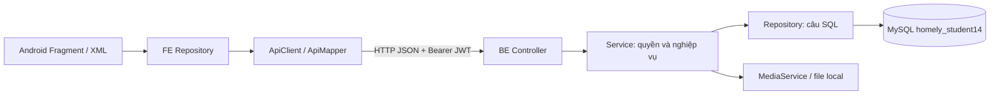
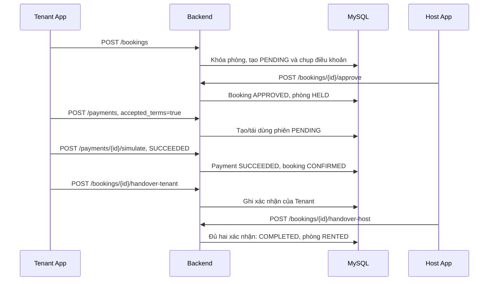

# ROOMLY — Tài liệu đọc hiểu dự án cho team

Ngày đối chiếu: **16/10/2026**. Phạm vi: `Frontend-Mobile-App` và backend profile `student14`.

Tài liệu mô tả source hiện có và database đã đối chiếu bằng truy vấn metadata chỉ đọc. Lần viết tài liệu này không sửa source, build lại ứng dụng, chạy UI automation hay thay đổi database. Kết quả kiểm thử demo ngày 15/10 được ghi riêng ở phần 10, không coi là một lần kiểm thử mới.

## 1. Nên đọc theo thứ tự nào?

| Người đọc | Phần nên đọc trước |
|---|---|
| Mới vào team | Phần 2–5: sản phẩm, kiến trúc, luồng chính |
| Làm frontend | Phần 4, 6–8: repository, API, kết nối emulator |
| Làm backend | Phần 3–7 và [tài liệu database](ROOMLY_DATABASE_GUIDE.md) |
| Chuẩn bị trả lời thầy | Phần 5, 10–11 và phần hỏi đáp trong tài liệu database |
| Cần xem từng cột | [Từ điển đầy đủ 227 cột](ROOMLY_DATABASE_GUIDE.md#11-từ-điển-đầy-đủ-các-cột) |

## 2. Roomly giải quyết bài toán gì?

Roomly là ứng dụng Android kết nối người tìm phòng và chủ trọ. Chủ trọ quản lý phòng, đăng tin kèm giá/cọc/phụ phí; Admin duyệt tin; người thuê tìm phòng, đặt lịch xem, gửi yêu cầu thuê, thanh toán cọc sandbox và xác nhận bàn giao.

Ba vai trò sử dụng cùng một ứng dụng:

| Vai trò | Công việc chính |
|---|---|
| Tenant — người thuê | Xem/lưu tin, xem phòng, nhắn tin, gửi yêu cầu thuê, thanh toán sandbox, bàn giao, đánh giá/báo cáo |
| Host — chủ trọ | Quản lý phòng và ảnh, tạo/sửa tin/phụ phí, gửi duyệt, mở lịch xem, duyệt yêu cầu thuê, bàn giao |
| Admin — quản trị | Duyệt/từ chối/tạm ngưng tin, quản lý trạng thái tài khoản, xem thống kê và xử lý báo cáo/khiếu nại |

Một tài khoản có thể có nhiều vai trò. Backend lưu các cờ `is_tenant`, `is_host`, `is_admin` trong `users`. Việc đổi chế độ hiển thị trên FE không tự cấp quyền ở backend. Mỗi request vẫn được kiểm tra quyền và quyền sở hữu dữ liệu.

## 3. Phần nào trong repository là bản Roomly cần hiểu?

| Thành phần | Bản được tài liệu này mô tả |
|---|---|
| Thư mục gốc trên máy hiện tại | `D:\BACKEND\Mobile` |
| Android app chính | `Frontend-Mobile-App`, package `com.example.roomly` |
| Backend xử lý nghiệp vụ | `backend/src/main/java/com/homely/student14` |
| Spring profile | `student14` |
| HTTP port mặc định | `18092`, bind mặc định `127.0.0.1` |
| API prefix | `/api/v1` |
| MySQL demo | `127.0.0.1:3306`, schema `homely_student14`, MySQL `8.0.45` |
| Cấu trúc DB đã đối chiếu | **14 bảng, 227 cột, 28 khóa ngoại** |
| Backend artifact | `backend/target/rental-student14.jar` |
| Debug APK | `Frontend-Mobile-App/app/build/outputs/apk/debug/app-debug.apk` |

Khi viết tài liệu, `/actuator/health` tại cổng 18092 trả `UP`. Đây là trạng thái tại thời điểm kiểm tra; sau khi restart máy cần kiểm tra lại.

### 3.1. Vì sao vẫn thấy package `rental`?

JAR có entry point `com.homely.rental.RentalApplication`. Hàm `main()` đọc `spring.profiles.active`: nếu có `student14`, nó khởi động `com.homely.student14.Student14Application`.

Vì vậy, chạy JAR phải truyền rõ:

```text
--spring.profiles.active=student14
```

Maven profile `-Pstudent14` đặt tên artifact. Spring profile ở lệnh chạy mới chọn runtime. **Build bằng `-Pstudent14` không thay thế việc chọn Spring profile khi chạy.**

Trong profile này, JPA/Hibernate và Flyway auto-configuration được tắt. Truy cập DB dùng `JdbcTemplate` qua Hikari. Các class trong `student14/entity` là model Java; không nên suy ra đây là JPA entity chỉ từ tên thư mục.

`Homely-android`, package backend `rental` cũ và `db/migration/V*.sql` còn trong repository nhưng không phải phần triển khai nghiệp vụ mà tài liệu này hướng dẫn. Đặc biệt, không lấy migration của backend cũ để chạy lên schema demo 14 bảng.

### 3.2. Stack đang khai báo trong source

| Phía | Công nghệ/cấu hình |
|---|---|
| Android | Java, XML layout, Fragment, ViewBinding, ViewModel/LiveData |
| Android SDK | `minSdk 24`, `compileSdk 37`, `targetSdk 37` |
| Android build | AGP `9.3.3`, Gradle wrapper `9.5.0`; nên dùng JBR của Android Studio đã build thành công |
| Mức ngôn ngữ Java FE | `sourceCompatibility`/`targetCompatibility` Java 11; khác với JDK dùng chạy Gradle |
| HTTP FE | `HttpURLConnection`, `org.json`, worker pool và callback về main thread |
| Backend | Java 17, Spring Boot `3.3.2`, Spring Web/Security/Validation/JDBC |
| Xác thực | JWT access token, refresh token lưu hash, BCrypt password |
| DB | MySQL 8, InnoDB, `utf8mb4`, dữ liệu thời gian xử lý theo UTC |
| Ảnh trong runtime student14 | File JPEG trên ổ đĩa, metadata trong bảng `media` |
| Thanh toán demo | `MOCK_SANDBOX`; không thu tiền thật |
| Push | Có tích hợp Firebase Admin/FCM, được bật/tắt bằng cấu hình |

Các dependency MinIO/WebSocket/JPA vẫn xuất hiện trong `pom.xml`. Chỉ nhìn dependency không đủ để kết luận profile `student14` đang dùng chúng. Ví dụ: `MediaService` hiện lưu file local; `ChatFragment` đang lấy tin nhắn qua REST theo chu kỳ.

## 4. Kiến trúc và cách tìm code



### 4.1. Backend

Đường dẫn gốc: `backend/src/main/java/com/homely/student14`.

| Thư mục | Trách nhiệm | Ví dụ |
|---|---|---|
| `controller` | Nhận HTTP, đọc JWT, validate DTO, trả response | `CatalogController`, `BookingController` |
| `dto/request` | Khai báo dữ liệu FE được gửi và ràng buộc đầu vào | `SaveListingDTO`, `CreateBookingDTO` |
| `dto/response` | Dữ liệu trả về được định nghĩa rõ cho một số luồng | `LoginResponse`, `UserAccountResponse` |
| `service` | Quyền truy cập, chuyển trạng thái, transaction | `CatalogService`, `BookingService` |
| `repository` | SQL đọc/ghi và khóa bản ghi | `CatalogRepository`, `BookingRepository` |
| `entity` | Model của phòng/tin/booking/payment và enum trạng thái | `Booking`, `ListingStatus` |
| `config` | Security, JWT, BCrypt, Firebase | `SecurityConfig`, `FirebaseConfig` |
| `exception` | Chuyển lỗi nghiệp vụ/validation/DB thành HTTP response | `ApiExceptionHandler` |

`DatabaseRepository` cung cấp các hàm dùng chung như `one`, `all`, `insert`, `update`, encode/decode JSON. Một số API trả `Map<String,Object>` thay vì DTO riêng; đọc tên cột SQL và `ApiMapper` để biết đầy đủ trường FE nhận.

### 4.2. Frontend

Đường dẫn gốc: `Frontend-Mobile-App/app/src/main/java/com/example/roomly`.

| Khu vực | Vai trò |
|---|---|
| `ui/explore`, `ui/detail`, `ui/saved` | Danh sách tin, chi tiết, yêu thích |
| `ui/host` | Quản lý phòng/tin/phụ phí |
| `ui/booking` | Yêu cầu thuê, duyệt, thanh toán, bàn giao, đánh giá |
| `ui/auth`, `ui/profile` | Đăng nhập/đăng ký/xác minh email và thông tin tài khoản |
| `ui/admin` | Duyệt tin, tài khoản, báo cáo, thống kê |
| `ui/messages`, `ui/schedule`, `ui/notification` | Chat, lịch xem, thông báo |
| `data/repository` | Gọi API và giữ dữ liệu cần cho màn hình |
| `data/api/ApiClient.java` | HTTP nền, timeout, session, refresh token, gỡ response wrapper |
| `data/api/ApiMapper.java` | Đổi JSON thành model Java FE |
| `data/model` | Model hiển thị, enum trạng thái, `ListingFee` |

Các repository API chính gồm `RoomRepository`, `HostRepository`, `BookingRepository`, `AuthRepository`, `AdminRepository`, `ViewingRepository`, `ChatRepository`, `ReportRepository`.

Các class tên `Demo...Repository` vẫn tồn tại, trong đó có repository lưu mẫu trong bộ nhớ. Khi tìm luồng đang dùng, hãy bắt đầu từ Fragment rồi theo repository nó gọi; không coi mọi class có chữ `Demo` là backend thật, cũng không xóa chúng để dọn repository trước demo.

### 4.3. Lifecycle cần hiểu

Các form Host dùng `HostSaveViewModel` với `SavedStateHandle` để quản lý lưu dữ liệu qua việc xoay màn hình hoặc chuyển app xuống nền. Trạng thái gồm `IDLE`, `SAVING`, `SAVED`, `ERROR`, `UNCERTAIN`.

Nếu tiến trình bị hủy lúc chưa biết kết quả lưu, app cần tải lại dữ liệu để đối chiếu, tránh tự gửi lại và tạo trùng. `ListingFeeEditor` quản lý dialog phụ phí và được giải phóng cùng view. `NavigationHelper` kiểm tra lifecycle trước khi điều hướng. Khi sửa màn hình, đừng giữ `binding` cũ trong callback hoặc điều hướng sau `onDestroyView`.

## 5. Các luồng nghiệp vụ quan trọng

### 5.1. Host tạo phòng → tạo tin → Admin duyệt → Tenant thấy tin

| Bước | Hành động | Dữ liệu thay đổi |
|---|---|---|
| 1 | Host tạo phòng | Thêm `rooms`, mặc định `AVAILABLE` |
| 2 | Host tải ảnh | Ghi JPEG local, thêm metadata `media` |
| 3 | Host lưu tin có giá/cọc/phụ phí | Thêm hoặc cập nhật `listings`, trạng thái `DRAFT` |
| 4 | Host gửi duyệt | `listings.status = PENDING_REVIEW` |
| 5 | Admin duyệt | `PUBLISHED`, ghi thời điểm công khai và hạn 30 ngày |
| 6 | Tenant mở Khám phá | API lấy tin `PUBLISHED`, còn hạn, phòng `AVAILABLE` |

`rooms` là phòng thực tế. `listings` là nội dung rao thuê và trạng thái duyệt. DB hiện có unique `listings.room_id`: **một phòng có tối đa một tin đăng**, có thể sửa và duyệt lại tin đó.

Host sửa một tin `PUBLISHED` sẽ làm tin về `DRAFT`, cần gửi Admin duyệt lại. `HIDDEN` là chủ trọ tự ẩn; `SUSPENDED` là Admin tạm ngưng. Hai trạng thái này có quyền thao tác khác nhau.

### 5.2. Thêm/sửa/xóa phụ phí

Phụ phí là mảng JSON trong `listings.fees`, không có bảng phụ phí riêng.

```json
[
  {
    "fee_code": "ELECTRICITY",
    "fee_mode": "PER_UNIT",
    "unit_name": "kWh",
    "amount_vnd": 4000
  },
  {
    "fee_code": "INTERNET",
    "fee_mode": "FIXED",
    "unit_name": "tháng",
    "amount_vnd": 100000
  }
]
```

FE dùng `ListingFee` và `ListingFeeEditor`; BE validate DTO, kiểm tra trùng mã, đơn vị và tiền rồi lưu toàn bộ mảng. Xóa Internet nghĩa là gửi lại mảng không còn phần tử Internet. `[]` là không có phụ phí; dữ liệu chưa tải được không được coi thành `[]` rồi lưu đè.

Mã hợp lệ: `ELECTRICITY`, `WATER`, `INTERNET`, `PARKING`, `CLEANING`, `SERVICE`, `OTHER`. Mỗi mã xuất hiện tối đa một lần. Cách tính là `FIXED` hoặc `PER_UNIT`; loại theo đơn vị bắt buộc có đơn vị. Tiền là số nguyên VND không âm, tối đa 18 chữ số. Đây là đơn giá/điều khoản hiển thị, chưa phải hệ thống đo điện nước và xuất hóa đơn hàng tháng.

### 5.3. Booking → sandbox → hai bên bàn giao



Điều kiện đáng nhớ:

- Tenant đã xác minh email, không đặt phòng của mình, số người không vượt sức chứa. Ngày vào ở phải **từ ngày mai theo giờ Việt Nam**.
- Giá/cọc lấy từ BE; khi tạo booking, BE lưu `terms_snapshot` gồm giá, cọc, phụ phí, phiên bản điều khoản và sức chứa.
- Request chờ duyệt có hạn 24 giờ. Host duyệt thì giữ phòng thêm 24 giờ để Tenant thanh toán.
- Phiên payment có hạn tối đa 30 phút và không vượt quá thời hạn giữ phòng.
- Payment sandbox thành công làm booking `CONFIRMED`. Nếu tiền cọc bằng 0, dùng luồng xác nhận điều khoản, không tạo payment 0 đồng.
- Sau xác nhận thuê, BE đặt `handover_due_at` sau 7 ngày. Job hiện chưa tự xử lý mọi trường hợp quá hạn bàn giao.
- Một bên xác nhận bàn giao chưa hoàn tất. Đủ hai bên mới `COMPLETED`, phòng thành `RENTED`.
- `COMPLETED` nghĩa là hoàn tất yêu cầu thuê/bàn giao; không có nghĩa người thuê đã trả phòng và kết thúc hợp đồng thuê dài hạn.

### 5.4. Các luồng hỗ trợ

| Luồng | Cách lưu hiện tại |
|---|---|
| Yêu thích | `wishlist_items` nối user với **room_id**, không nối listing_id |
| Xem phòng | Một bảng `viewings` dùng cho cả khung giờ trống và yêu cầu đã có Tenant |
| Chat | `conversations` theo phòng + Tenant; `messages` theo thứ tự `sequence`; FE poll khoảng 4 giây khi mở chat |
| Thông báo trong app | Bản ghi `notifications`; vẫn tách biệt với việc gửi FCM |
| Push điện thoại | FCM token trong `users`; job gửi các notification khi cấu hình được bật |
| Đánh giá | `reviews`, Tenant chỉ đánh giá booking đã `COMPLETED`, một review/booking |
| Báo cáo/khiếu nại | Cùng bảng `reports`, phân biệt bằng `target_type`; API hiện nhận `listing` và `booking` |

## 6. FE và BE trao đổi dữ liệu thế nào?

### 6.1. URL, token và ID

`BuildConfig.API_BASE_URL` được sinh khi build từ Gradle property `ROOMLY_API_URL`. Đổi biến trên máy sau khi đã cài APK không tự đổi URL của APK đó; phải build/cài lại nếu muốn đổi URL.

FE gửi `Authorization: Bearer <access_token>` cho API cần đăng nhập. `ApiClient` lưu session trong SharedPreferences, tự refresh khi nhận 401 trong các tình huống được hỗ trợ. Access token có hạn 15 phút; refresh token 30 ngày, được rotate sau khi dùng.

ID database là `BIGINT`. FE có model dùng `String` để chứa ID: khi nối URL vẫn phải dùng ID backend trả về. **Không nhầm `room_id`, `listing_id`, `booking_id`, `payment_id`**, dù dữ liệu demo có lúc chúng cùng giá trị.

### 6.2. Response wrapper

```json
{
  "statusCode": 200,
  "message": "OK",
  "data": {
    "data": [],
    "total_elements": 0,
    "total_pages": 0,
    "current_page": 0,
    "page_size": 0
  }
}
```

Đây là ví dụ API danh sách. `ApiClient` bỏ lớp `data` ngoài; `ApiMapper` đọc tiếp mảng `data` của đối tượng danh sách. API chi tiết trả object trong `data` ngoài.

`DatabaseRepository.page()` hiện đóng gói toàn bộ danh sách thành một trang; chưa phải phân trang server đầy đủ. Thuộc tính nghiệp vụ thường dùng `snake_case`; riêng `statusCode` giữ đúng camelCase như trên.

`DECIMAL` qua `DatabaseRepository` thường được chuẩn hóa thành chuỗi số, ví dụ `"3100000"`. JSON request có thể gửi số/chuỗi hợp lệ theo DTO, nhưng không gửi tiền đã định dạng như `"3.100.000 đ"`. Thời gian API trả ISO-8601 UTC, thường có `Z`; ngày vào ở là `YYYY-MM-DD`.

### 6.3. Các mã lỗi hay gặp

| HTTP | Ý nghĩa cần kiểm tra |
|---|---|
| 400 | Sai trường nhập, ngày vào ở, tiền, số người hoặc hành động |
| 401 | Chưa đăng nhập/token không hợp lệ hoặc hết phiên |
| 403 | Sai quyền, không sở hữu đối tượng hoặc chưa xác minh email |
| 404 | Không tìm thấy dữ liệu; API mô phỏng cũng có thể trả 404 khi bị tắt |
| 409 | Trạng thái đã đổi, phòng đang được giữ, vi phạm unique/check/FK |
| 429 | Yêu cầu mã email thật quá nhanh/quá nhiều |
| 503 | Chưa bật gửi mail thật và cũng không bật mail mô phỏng |

Gặp 409 thì tải lại trạng thái hiện tại trước khi thử tiếp; không đổi ID hoặc sửa trực tiếp MySQL để vượt điều kiện nghiệp vụ.

## 7. Bản đồ API để tìm nhanh

Các path dưới đây tính từ `/api/v1`. Quyền chính xác còn được kiểm tra trong service.

| Nhóm | API chính | Controller |
|---|---|---|
| Auth | `POST /auth/register`, `/auth/login`, `/auth/refresh`, `/auth/logout` | `AuthController` |
| Tài khoản | `GET /auth/account` hoặc `/profile`, `PUT /profile`, `POST /auth/enable-host` | `AuthController` |
| Mã email | `POST /auth/verification-code`, `/auth/recovery-code`, `/auth/verify-email`, `/auth/reset-password` | `AuthController` |
| Tin công khai | `GET /listings`, `GET /listings/{listingId}`, `GET /amenities` | `CatalogController` |
| Phòng của Host | `GET /rooms`, `GET /rooms/{roomId}`, `POST /rooms`, `PUT /rooms/{roomId}` | `CatalogController` |
| Quản lý tin | `GET /listings/my`, `POST /listings/room/{roomId}`, `POST /listings/{listingId}/submit` hoặc `/hide` | `CatalogController` |
| Admin duyệt tin | `GET /admin/listings`, `POST /admin/listings/{listingId}/approve`, `/reject`, `/suspend` | `AdminController` |
| Ảnh | `POST /rooms/{roomId}/image`, `DELETE /rooms/{roomId}/image`, `GET /media/{mediaId}/content` | `MediaController` |
| Yêu thích | `GET /wishlist`, `POST /wishlist/{roomId}`, `DELETE /wishlist/{roomId}` | `CatalogController` |
| Booking | `POST /bookings`, `GET /bookings/my`, `/bookings/host`, `/bookings/{bookingId}` | `BookingController` |
| Xử lý booking | `POST /bookings/{bookingId}/approve`, `/reject`, `/cancel`, `/confirm-deposit` | `BookingController` |
| Bàn giao | `POST /bookings/{bookingId}/handover-tenant` hoặc `/handover-host` | `BookingController` |
| Payment | `POST /payments`, `GET /payments/booking/{bookingId}`, `POST /payments/{paymentId}/simulate` | `BookingController` |
| Review | `POST /reviews`, `GET /rooms/{roomId}/reviews` | `BookingController`, `CatalogController` |
| Lịch xem | `GET /viewings/my`, `/viewings/host`, `/viewings/room/{roomId}?host=true`, `POST /viewings` | `ViewingController` |
| Xử lý lịch | `POST /viewings/{viewingId}/request`, `/approve`, `/reject`, `/cancel`, `/reopen` | `ViewingController` |
| Chat | `GET/POST /conversations`, `GET /conversations/{id}`, `GET/POST /conversations/{id}/messages` | `ChatController` |
| Notification | `GET /notifications`, `POST /notifications/{id}/read` | `NotificationController` |
| FCM | `PUT/DELETE /profile/device-token` | `PushController` |
| Báo cáo | `POST /reports`, `GET /reports/my`, `/bookings/{bookingId}/cases` | `ReportController` |
| Admin báo cáo | `GET /admin/reports` hoặc `?cases=true`, `POST /admin/reports/{id}/resolve` | `ReportController` |
| Admin tài khoản | `GET /admin/users`, `POST /admin/users/{id}/suspend` hoặc `/activate`, `GET /admin/summary` | `AdminController` |

## 8. Hướng dẫn chạy bản local

Các lệnh trong phần này để người đọc tự sử dụng khi cần. Không chạy lại một backend nếu cổng 18092 đã có bản đang phục vụ demo. Không import/reset schema để khởi động ứng dụng.

### 8.1. Biến môi trường backend

| Biến | Ý nghĩa / mặc định |
|---|---|
| `STUDENT14_DB_HOST`, `STUDENT14_DB_PORT` | `127.0.0.1`, `3306` |
| `STUDENT14_DATABASE` | `homely_student14` |
| `STUDENT14_DB_USER` | User MySQL, mặc định `homely_student14` |
| `STUDENT14_DB_PASSWORD` | Mật khẩu MySQL; bắt buộc cung cấp, không ghi vào Git |
| `STUDENT14_JWT_SECRET` | Khóa ký JWT; bắt buộc cung cấp, không ghi vào Git |
| `STUDENT14_HTTP_PORT` | `18092` |
| `STUDENT14_BIND_ADDRESS` | `127.0.0.1`; phù hợp emulator/USB reverse local |
| `STUDENT14_MEDIA_DIRECTORY` | Nên dùng đường dẫn tuyệt đối tới đúng thư mục ảnh hiện có |
| `STUDENT14_MOCK_PAYMENT_ENABLED` | Mặc định `true` trong profile; cho phép sandbox |
| `STUDENT14_MOCK_MAIL_ENABLED` | Mặc định `true` trong profile; trả mã demo |
| `STUDENT14_MAIL_ENABLED` | Mặc định `false`; email thật còn cần cấu hình SMTP |
| `STUDENT14_PUSH_ENABLED` | Mặc định `false` |
| `STUDENT14_FIREBASE_PROJECT_ID` | ID Firebase khi bật push |
| `STUDENT14_FIREBASE_CREDENTIALS` | Đường dẫn JSON Firebase Admin khi bật push |

Default media-directory là `./Infra/student14/.local/media`, được tính từ **working directory của tiến trình Java**. Chạy từ thư mục khác có thể trỏ sang thư mục ảnh khác. Khi dùng dữ liệu demo hiện có, nên chỉ định tuyệt đối `D:/BACKEND/Mobile/Infra/student14/.local/media`.

### 8.2. Chạy JAR trên máy hiện tại

Máy hiện tại đã có file cấu hình riêng. Team dùng máy khác cần tự có cấu hình DB/JWT tương ứng; file riêng này không phải thành phần để commit.

```powershell
cd D:\BACKEND\Mobile\backend
$config = Get-Content '..\Infra\student14\.local\connection-private.json' -Raw | ConvertFrom-Json
$env:STUDENT14_DB_USER = $config.user
$env:STUDENT14_DB_PASSWORD = $config.password
$env:STUDENT14_DATABASE = $config.database
$env:STUDENT14_JWT_SECRET = $config.jwt_secret
$env:STUDENT14_MEDIA_DIRECTORY = 'D:/BACKEND/Mobile/Infra/student14/.local/media'

& 'C:\Program Files\Java\jdk-17\bin\java.exe' -jar '.\target\rental-student14.jar' `
  --spring.profiles.active=student14 `
  --server.port=18092 `
  --student14.mock-payment-enabled=true `
  --student14.mock-mail-enabled=true `
  --student14.mail-enabled=false `
  --student14.push-enabled=false
```

Lệnh này chạy foreground. Muốn chạy nền, sau khi đã nạp cùng các biến môi trường ở trên, dùng lệnh dưới ở lần khởi động cần chạy nền; không khởi động thêm nếu bản foreground vẫn chiếm cổng.

```powershell
$backendArgs = @(
    '-jar', 'target/rental-student14.jar',
    '--spring.profiles.active=student14',
    '--server.port=18092',
    '--student14.mock-payment-enabled=true',
    '--student14.mock-mail-enabled=true',
    '--student14.mail-enabled=false',
    '--student14.push-enabled=false'
)
Start-Process -FilePath 'C:\Program Files\Java\jdk-17\bin\java.exe' `
    -ArgumentList $backendArgs `
    -WorkingDirectory 'D:\BACKEND\Mobile\backend' `
    -WindowStyle Hidden `
    -RedirectStandardOutput '.\target\backend-background.out.log' `
    -RedirectStandardError '.\target\backend-background.err.log' `
    -PassThru
```

`Start-Process` cho phép đóng terminal mà backend tiếp tục chạy. Máy phải còn hoạt động và MySQL phải chạy; cách này chưa tự khởi động lại backend khi restart máy hoặc khi Java bị lỗi. Khóa màn hình vẫn chạy nếu máy không Sleep.

### 8.3. Kiểm tra backend

```powershell
Invoke-RestMethod http://127.0.0.1:18092/actuator/health
Get-NetTCPConnection -LocalPort 18092 -State Listen |
    Select-Object LocalPort, OwningProcess
```

PID do `Start-Process` trả về mới chỉ chứng minh đã tạo process, chưa chứng minh Spring Boot khởi động thành công. Cần health `UP`. Nếu cổng đã do PID khác giữ, không khởi chạy lặp lại.

### 8.4. Build và cài FE để dùng emulator/USB reverse

Trong PowerShell dành cho FE:

```powershell
cd D:\BACKEND\Mobile\Frontend-Mobile-App
$env:JAVA_HOME = 'C:\Program Files\Android\Android Studio\jbr'
$env:ANDROID_HOME = 'C:\Users\PC\AppData\Local\Android\Sdk'
.\gradlew.bat "-Dorg.gradle.java.home=$env:JAVA_HOME" `
    -PROOMLY_API_URL=http://127.0.0.1:18092/api/v1/ :app:assembleDebug

& "$env:ANDROID_HOME\platform-tools\adb.exe" -s emulator-5554 reverse tcp:18092 tcp:18092
& "$env:ANDROID_HOME\platform-tools\adb.exe" -s emulator-5554 install -r '.\app\build\outputs\apk\debug\app-debug.apk'
```

`emulator-5554` là serial emulator dùng trong vòng nghiệm thu trước; dùng `adb devices` để xác định serial trên máy khác. Sau khi emulator/điện thoại reconnect hoặc restart, có thể cần thiết lập lại `adb reverse`.

Hai cách kết nối local:

| URL được build vào APK | Cách sử dụng |
|---|---|
| `http://127.0.0.1:18092/api/v1/` | Cần `adb reverse`; dùng được cho emulator và điện thoại USB |
| `http://10.0.2.2:18092/api/v1/` | Default Gradle, dành cho Android emulator truy cập máy host |

`10.0.2.2` không phải địa chỉ dùng chung cho điện thoại thật. Build release được cấu hình yêu cầu URL HTTPS không phải localhost; để demo local dùng `:app:assembleDebug`. Không đổi Gradle/SDK chỉ vì đang cần chạy bản demo.

### 8.5. Lỗi `jlink.exe does not exist`

Đường dẫn lỗi từng trỏ tới JRE của extension Red Hat Java trong VS Code. Android build cần bộ Java có đủ công cụ. Với dự án này, dùng JBR của Android Studio như lệnh trên.

Trong Android Studio: **Settings → Build, Execution, Deployment → Build Tools → Gradle → Gradle JDK**, chọn `C:\Program Files\Android\Android Studio\jbr`.

Trong VS Code User Settings có thể thêm thuộc tính chỉ định JDK cho Gradle (giữ các cấu hình khác đã có):

```json
{
  "java.import.gradle.java.home": "C:\\Program Files\\Android\\Android Studio\\jbr"
}
```

Đây là cấu hình môi trường của từng máy, không phải yêu cầu sửa nghiệp vụ FE.

### 8.6. Build backend và chạy test khi thực sự cần

Các lệnh này tạo lại artifact; không cần chạy chỉ để đọc tài liệu hoặc sử dụng JAR đang hoạt động.

```powershell
cd D:\BACKEND\Mobile\backend
$env:JAVA_HOME = 'C:\Program Files\Java\jdk-17'
.\apache-maven-3.9.9\bin\mvn.cmd -Pstudent14 -DskipTests package
```

Trên máy khác có Maven toàn cục có thể dùng `mvn` thay đường dẫn Maven trên. Wrapper `mvnw.cmd` từng gặp lỗi quoting trên máy demo; vòng build đã dùng Maven local. Không cần sửa wrapper để mở bản đã build.

Các test liên quan đã dùng:

```powershell
# Trong backend
.\apache-maven-3.9.9\bin\mvn.cmd -Pstudent14 `
  '-Dtest=CatalogFeeTest,CatalogServicePolicyTest,AuthChallengeServiceTest,EmailServiceTest,PushServiceTest' test

# Trong Frontend-Mobile-App
.\gradlew.bat :app:testDebugUnitTest
.\gradlew.bat :app:connectedDebugAndroidTest `
  '-Pandroid.testInstrumentationRunnerArguments.class=com.example.roomly.HostSaveLifecycleTest,com.example.roomly.ListingFeeJsonTest'
```

Không chạy lại instrumentation khi người khác đang tự test app trên cùng emulator. Các test có ghi DB cần DB test riêng hoặc bộ dữ liệu DEMO đã được cho phép; không reset DB demo để test.

## 9. Firebase và email: phân biệt đúng cấu hình

| Thành phần | Dùng ở đâu | Vai trò |
|---|---|---|
| `google-services.json` | Android app | Cấu hình Firebase phía client; plugin Google Services của FE cần cấu hình phù hợp |
| JSON Firebase Admin | Backend, qua đường dẫn `STUDENT14_FIREBASE_CREDENTIALS` | Thông tin xác thực server, có khóa riêng; không nhúng vào APK hoặc commit Git |
| FCM token | `users.fcm_token` | Địa chỉ thiết bị để gửi push, khác access token đăng nhập |
| SMTP | Backend gửi email | Độc lập với FCM; cần cấu hình gửi mail thật |

Trong lệnh demo local ở trên: payment mô phỏng bật, email mô phỏng bật, gửi mail thật tắt, push tắt. Mã email demo có thể xuất hiện trong response ở chế độ mô phỏng; email thật thì không trả mã đó cho client. Code yêu cầu mã có hạn 10 phút; gửi thật có giới hạn tối thiểu 60 giây giữa hai lần và tối đa 5 mã/giờ theo tài khoản/mục đích.

Bảng `notifications` vẫn có thông báo trong app khi push tắt. Việc có code Firebase hoặc có thư viện `firebase-admin` không chứng minh đã cấu hình gửi push thành công. Bật push khi thiếu project ID/credentials hợp lệ có thể làm backend không khởi động.

## 10. Kịch bản demo và mức độ đã kiểm chứng

### 10.1. Kịch bản cho cả team

| Thứ tự | Vai trò | Thao tác | Kết quả mong đợi |
|---|---|---|---|
| 1 | Host | Tạo phòng mới có mã DEMO, thêm ảnh | Phòng có ID backend, ảnh mở được |
| 2 | Host | Tạo tin, thêm điện và Internet | Lưu `DRAFT`, phụ phí còn khi mở lại |
| 3 | Host | Sửa điện, xóa Internet, lưu | BE/MySQL chỉ còn khoản điện với giá mới |
| 4 | Host | Gửi duyệt | `PENDING_REVIEW`, không còn sửa như bản nháp |
| 5 | Admin | Duyệt đúng tin | `PUBLISHED` |
| 6 | Tenant | Mở Khám phá/chi tiết tin | Thấy tin, ảnh, giá và phụ phí đúng |
| 7 | Tenant | Gửi booking, chọn ngày từ ngày mai | `PENDING` |
| 8 | Host | Duyệt booking | `APPROVED`, phòng `HELD` |
| 9 | Tenant | Đồng ý điều khoản, thanh toán sandbox thành công | Payment `SUCCEEDED`, booking `CONFIRMED` |
| 10 | Tenant và Host | Mỗi bên xác nhận bàn giao | `COMPLETED`, phòng `RENTED` |

Sau bước 8, tin có thể không còn trong feed công khai vì phòng đang được giữ. Sau bước 10, phòng đã cho thuê nên không dùng lại để tạo booking mới ngay. Đây là điều kiện nghiệp vụ; dùng một phòng DEMO mới để chạy lại toàn bộ chuỗi thay vì đổi trạng thái bằng SQL.

### 10.2. Bằng chứng đã có

Vòng nghiệm thu ngày **15/10/2026** ghi nhận:

| Kiểm tra | Kết quả đã ghi nhận |
|---|---|
| Backend: CatalogFee, CatalogServicePolicy, AuthChallenge, EmailService, PushService | 70 test PASS |
| FE unit: ExampleUnit, ListingFee, ListingStatus | 16 test PASS |
| Emulator: HostSaveLifecycle và ListingFeeJson | 13 test PASS |
| Host tạo phòng/tin/phụ phí, Admin duyệt, Tenant xem | PASS qua app Android nối BE thật |
| Host sửa điện thành 4.000đ/kWh và xóa Internet | PASS qua UI; đối chiếu MySQL |
| Booking → Host duyệt → sandbox → hai bên bàn giao | PASS; booking #40, room/listing #38, trạng thái `COMPLETED` |

ID #38/#40 là dữ liệu của lần kiểm thử đó, không phải hằng số để hardcode trong app. Khi còn artifact local có thể xem `backend/target/mobile-verification/report.json` và các report trong `target/surefire-reports`, `app/build/test-results`, `app/build/outputs/androidTest-results`. Các thư mục build này không phải source cần commit.

Tài liệu này không khẳng định toàn bộ project đã production-ready. Thanh toán thật, VPS/domain/HTTPS, push thật, email thật trong cấu hình runtime hiện tại và mọi nhánh chức năng phụ chưa được nghiệm thu lại trong lần viết tài liệu.

## 11. Câu hỏi thường gặp của team

**Tại sao đăng tin rồi Tenant chưa thấy?** Kiểm tra `PUBLISHED`, hạn tin và `rooms.availability = AVAILABLE`. Bản nháp/chờ duyệt không vào feed. Sau sửa tin cần duyệt lại; sau giữ phòng/cho thuê thì không còn là phòng trống.

**Tại sao không gộp phòng với tin?** Phòng chứa thông tin vật lý và tình trạng trống/giữ/cho thuê. Tin chứa nội dung quảng bá, giá/phụ phí và trạng thái duyệt. Hai vòng đời khác nhau, tách ra giúp xử lý rõ hơn.

**Mỗi lần sửa tin có tạo tin mới không?** Không trong schema này. Unique `listings.room_id` giữ tối đa một tin/phòng; API lưu lại tin hiện có và đưa về `DRAFT` khi sửa.

**Host đổi giá thì booking cũ đổi theo không?** Giá/cọc và phụ phí thỏa thuận đã được lưu trong booking/snapshot. Tuy nhiên một số nhãn hiển thị như tiêu đề/địa chỉ hiện vẫn JOIN dữ liệu phòng/tin hiện tại; không nên mô tả snapshot là bản sao toàn bộ phòng.

**Thanh toán thành công là đã bàn giao chưa?** Chưa. Sandbox thành công xác nhận thuê; cả Tenant và Host cần xác nhận bàn giao để hoàn tất.

**Hai người cùng thuê một phòng thì sao?** BE khóa phòng trong transaction; DB còn có unique trên booking đang được giữ/xác nhận. Nhiều Tenant có thể gửi request `PENDING`, nhưng chỉ một request được giữ phòng tại một thời điểm.

**Tiền cọc có chuyển thật không?** Luồng demo dùng `MOCK_SANDBOX`. Tên `VNPAY`/`MOMO` được schema cho phép không đồng nghĩa đã tích hợp cổng thanh toán thật.

**Tại sao FE chạy mà dữ liệu không lên?** Kiểm tra backend health, URL đã build vào APK, `adb reverse` nếu dùng 127.0.0.1, phiên đăng nhập và quyền của tài khoản. FE không kết nối MySQL trực tiếp.

**Tại sao đổi đường dẫn chạy backend thì mất ảnh?** DB chỉ lưu tên file. Nếu `STUDENT14_MEDIA_DIRECTORY` trỏ khác thư mục đã upload, backend không tìm được file. Dùng đúng đường dẫn tuyệt đối; không cần xóa dữ liệu DB.

**Cần push gì cho team?** Source FE/BE, test và cấu hình build cần thiết; bảo đảm bootstrap/profile `student14` đi kèm. Tài liệu mới này có thể commit. Không commit mật khẩu/JWT key, JSON Admin, `.env`, file private, DB dump chứa dữ liệu, log, APK/JAR hay thư mục build. Không cần xóa `Homely-android` để demo.

## 12. Điểm bắt đầu để tra source

- [Cấu hình runtime student14](../backend/src/main/resources/application-student14.properties).
- [Bootstrap chọn profile](../backend/src/main/java/com/homely/rental/RentalApplication.java).
- [Controller catalog](../backend/src/main/java/com/homely/student14/controller/CatalogController.java) và [CatalogService](../backend/src/main/java/com/homely/student14/service/CatalogService.java).
- [BookingService](../backend/src/main/java/com/homely/student14/service/BookingService.java), [BookingRepository](../backend/src/main/java/com/homely/student14/repository/BookingRepository.java), [job hết hạn](../backend/src/main/java/com/homely/student14/service/BookingExpiryJob.java).
- [ApiClient Android](../Frontend-Mobile-App/app/src/main/java/com/example/roomly/data/api/ApiClient.java) và [ApiMapper](../Frontend-Mobile-App/app/src/main/java/com/example/roomly/data/api/ApiMapper.java).
- [Gradle app](../Frontend-Mobile-App/app/build.gradle.kts).
- [Database: bảng, cột, khóa, trạng thái, SQL và hỏi đáp](ROOMLY_DATABASE_GUIDE.md).
